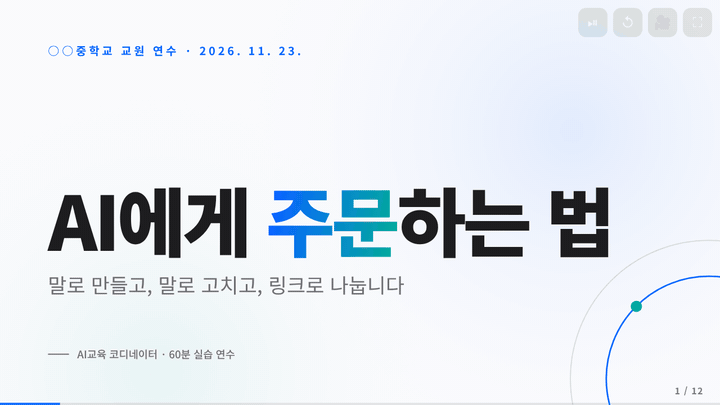
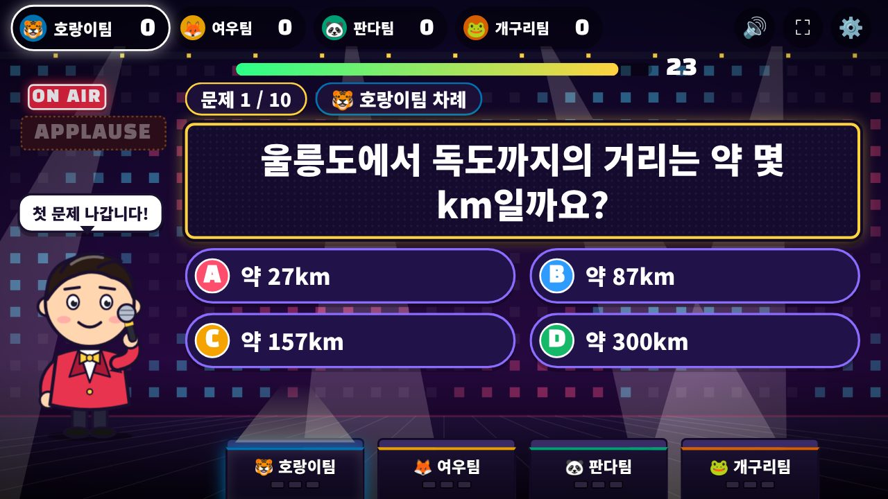
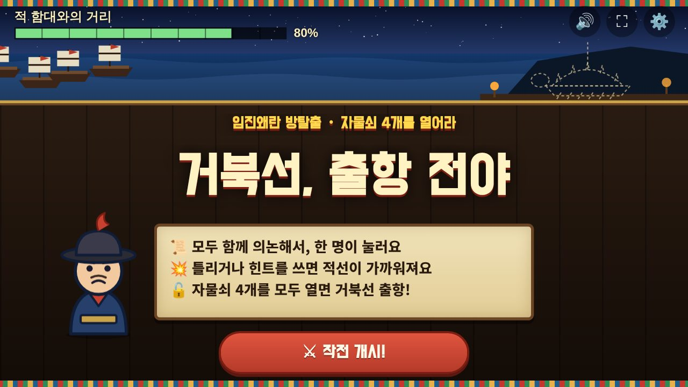
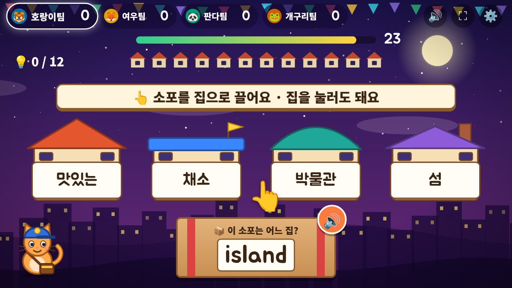
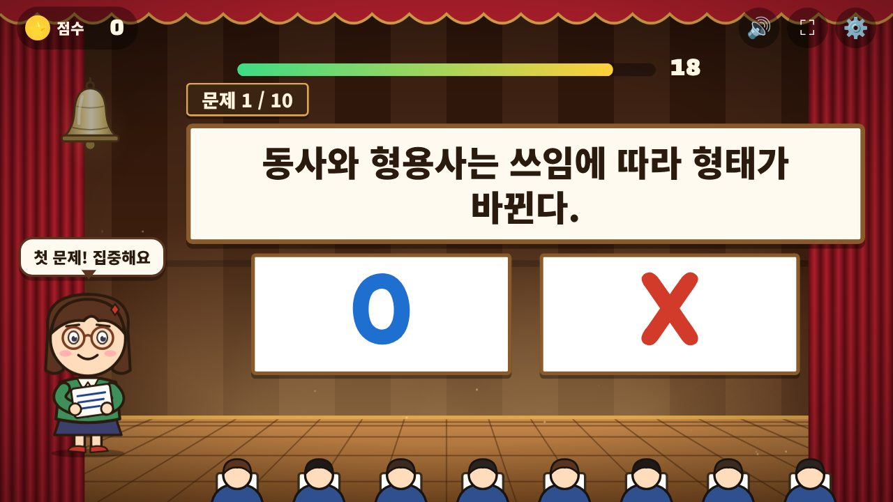
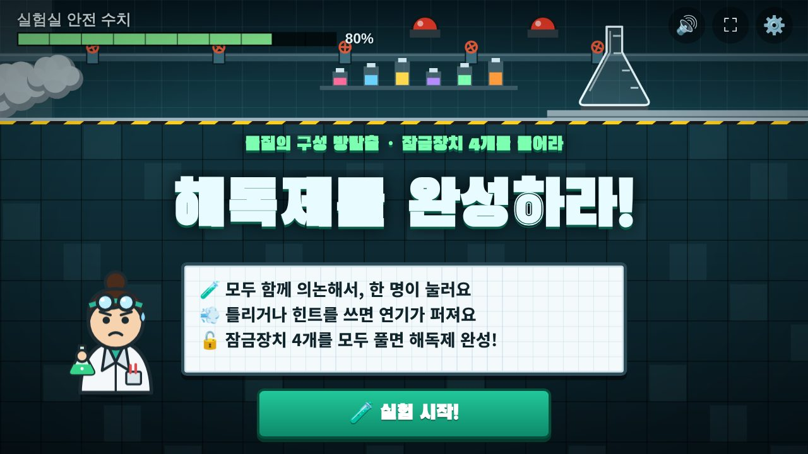
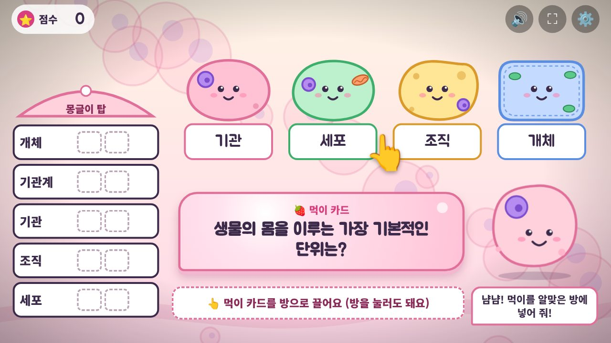
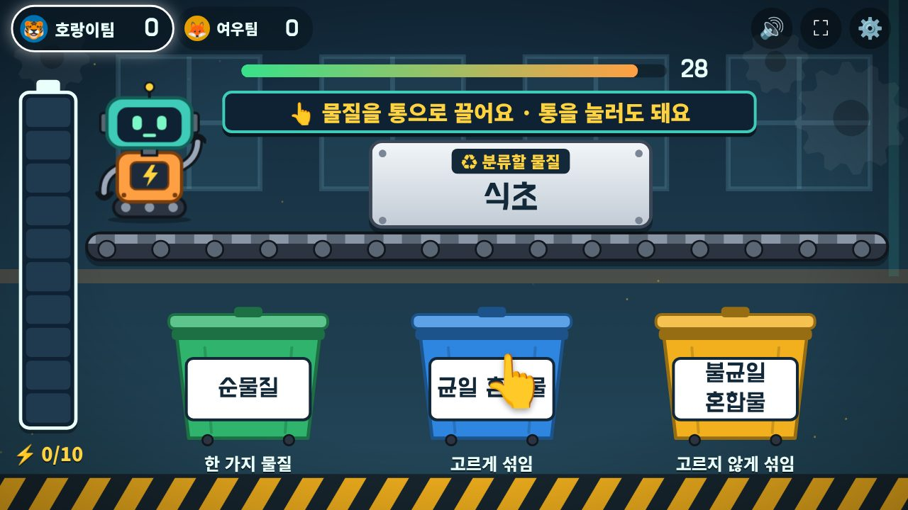
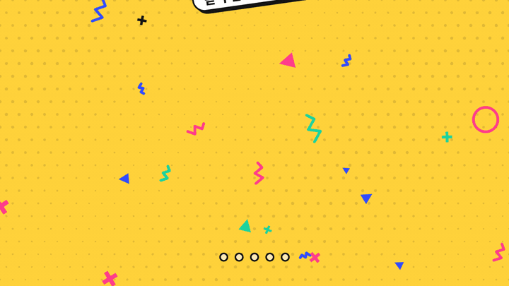
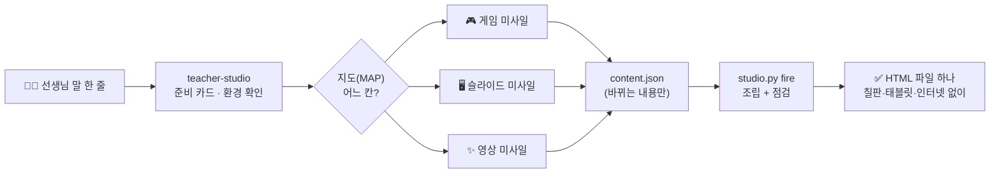

<div align="center">

<picture>
  <source media="(prefers-color-scheme: dark)" srcset="docs/assets/banner-dark.svg">
  
</picture>

<p>
  
  
  
  
  
  
</p>

**코딩을 몰라도 됩니다.** 선생님이 평소 말투로 부탁하면 Claude·Codex가<br>
미리 만들어 시험까지 끝낸 **완제품(미사일)** 을 꺼내 수업 게임·슬라이드·영상을 **몇 분 만에** 만들어 드립니다.

[시작하기](#-시작하기-주문-한-줄) · [미리보기](#-미리보기) · [무기고](#-무기고-지금-바로-만들-수-있는-것) · [어디서 되나요](#-어디서-무엇이-되나요) · [이렇게 말해 보세요](docs/prompts.md) · [자주 묻는 질문](#-자주-묻는-질문)

</div>

---

## ✨ 그냥 채팅과 무엇이 다른가요

| | 그냥 AI 채팅 | 교사 스튜디오를 깐 AI |
|---|---|---|
| 만드는 방식 | 매번 처음부터 | 시험을 끝낸 **완제품에 내용만** 넣기 |
| 품질 | 판마다 들쭉날쭉 | 캐릭터·연출·효과음까지 **늘 같은 수준** |
| 교실 맞춤 | 직접 말해야 함 | 칠판 글씨 크기·태블릿 터치·선생님 메뉴가 **기본** |
| 실수 | 그대로 나감 | **점검기**가 오래된 크롬 오류·겹침을 걸러 냄 |
| 말 알아듣기 | 개발 용어로 대답 | 「칠판에 띄울 거」「애들이 헷갈려해」를 **바로 작업으로** |

---

## 🚀 시작하기 (주문 한 줄)

> [!TIP]
> 아래 문장을 **복사해서 붙여 넣기만** 하면 AI가 알아서 설치하고, 끝나면 「준비 완료」 안내와 메뉴를 보여 드려요.

<details open>
<summary><b>💻 Claude Code 또는 Codex를 쓰는 경우</b> (권장)</summary>

```text
https://github.com/zln02/teacher-studio 의 INSTALL.md를 읽고 그대로 설치해 줘. 나는 선생님이고 코딩은 몰라.
```

설치가 끝나면 새 대화에서 **「교사 스튜디오 시작」** 이라고 말하거나, 만들고 싶은 걸 바로 말하세요.
</details>

<details>
<summary><b>💬 Claude 앱·웹(claude.ai)을 쓰는 경우</b></summary>

1. 이 페이지의 [`dist/`](dist/) 폴더에서 zip 4개를 받습니다: `teacher-studio` · `teacher-game` · `teacher-slides` · `teacher-motion`
2. Claude 앱 → **설정 → 스킬(Skills)** 에서 zip을 하나씩 올립니다. (메뉴 이름은 앱 버전에 따라 조금 다를 수 있어요)
3. 설정에서 **코드 실행 및 파일 만들기**가 켜져 있는지 확인합니다.
4. 새 대화에서 **「교사 스튜디오 시작」** 이라고 말합니다.
</details>

### 💬 설치 후 첫 화면

```text
🎉 교사 스튜디오 준비 완료!
· 지금 쓰는 곳: Claude Code          · 결과 보기: 크롬 창으로 자동으로 열어요
· 영상: MP4 영상 파일까지 바로 만들어요   · 나누기: 학교 드라이브·USB로 / 링크는 Claude 앱 '게시'

무엇을 만들까요? 번호나 말로 편하게 말씀해 주세요.
1. 🎮 수업 게임 — 퀴즈쇼·골든벨 / 방탈출 / 끌어서 보내기(단어·분류)
2. 🖥 수업 슬라이드 — 칠판 / 깔끔한 발표 / 파스텔 노트
3. ✨ 과목 소개 영상 — 첫 시간에 틀 30~40초 영상
4. ⏱ 수업 시작 화면 — 카운트다운 + 오늘의 주제
5. 💬 그냥 말로 할게요 (예: 「중2 과학 빛과 파동 방탈출, 칠판용」)
```

이미 원하는 걸 말했다면 메뉴 없이 바로 만들고, **이 환경에서 안 되는 기능이 있으면 한 줄로 먼저 알려 드려요.**

---

## 🎬 미리보기

<table>
<tr>
<td width="50%"><br><sub><b>🎮 퀴즈쇼</b> · 방송국 — 진행자·박수 전광판·팀 단상</sub></td>
<td width="50%"><br><sub><b>✨ 과목 소개 영상</b> · 과학 네온 — MP4로도 저장</sub></td>
</tr>
<tr>
<td><br><sub><b>🖥 수업 슬라이드</b> · 키노트형 — 한 줄씩 등장·퀴즈 공개</sub></td>
<td><br><sub><b>✨ 과목 소개 영상</b> · 국어 붓글씨 — 먹 번짐·낙관</sub></td>
</tr>
</table>

<details>
<summary><b>🎮 게임 9종 전체 보기</b></summary>

| 퀴즈쇼 | 방탈출 | 끌어서 보내기 |
|---|---|---|
| <br><sub>방송국</sub> | <br><sub>거북선 작전실</sub> | <br><sub>달밤 우체국 (영어 발음)</sub> |
| <br><sub>강당 골든벨</sub> | <br><sub>해독제 실험실</sub> | <br><sub>세포 먹이 주기</sub> |
| <br><sub>우주 정거장</sub> | <br><sub>태양 신전</sub> | <br><sub>분리수거 로봇</sub> |

</details>

<details>
<summary><b>⏱ 수업 시작 화면</b></summary>


</details>

---

## 🧰 무기고 (지금 바로 만들 수 있는 것)

| 칸 | 미사일 (완제품) | 스킨 | 이럴 때 |
|---|---|---|---|
| 🎮 수업 게임 | **퀴즈쇼** | 방송국 · 강당 골든벨 · 우주 정거장 | 퀴즈·OX·골든벨, 칠판 모둠전 |
| | **방탈출** | 거북선 작전실 · 해독제 실험실 · 태양 신전 | 단원 마무리, 반 전체 협동 (3~6단계) |
| | **끌어서 보내기** | 달밤 우체국 · 세포 먹이 · 분리수거 로봇 | 단어 뜻, 분류, 짝 맞추기, 태블릿 |
| 🖥 슬라이드 | **수업·연수 발표** (화면 구성 13종) | 칠판 · 키노트형 · 파스텔 노트 | 수업 PPT 대신, 연수·설명회 |
| ✨ 영상·화면 | **과목 소개 영상** | 과학 네온 · 국어 붓글씨 · 영어 뉴스 | 첫 시간, 과목 홍보 |
| | **수업 시작 화면** | 팝 · 종이 | 집중시키기, 오늘의 주제 |

> [!NOTE]
> 스킨은 출발점일 뿐이에요. **어디에 쓸지, 어떤 느낌인지, 참고 사진·영상**을 주시면 색·글씨·속도를 그 느낌으로 바꿔 만들어요.
> 완제품에 없는 요청도 같은 엔진·디자인·점검기로 직접 만들어 드려요 (조금 더 걸려요).

**준비 중** 📄 가정통신문·공문(한글) · 📊 PPT 파일 · 🎬 영상 편집(자르기·자막·사진 영상) · 📝 학습지 · 🧰 수업 도구(타이머·뽑기·모둠) · 🔎 자료 조사 → [로드맵](#-로드맵)

---

## ✅ 어디서 무엇이 되나요

| 기능 | Claude 앱·웹 | Claude Code | Codex |
|---|:---:|:---:|:---:|
| 미사일로 만들기 + 자동 점검 | ✅ <sub>코드 실행 켜기</sub> | ✅ | ✅ |
| 결과 바로 보기 | ✅ 오른쪽 화면 | ✅ 크롬 자동 열기 | ✅ 크롬 열기 |
| 공유 링크·QR | ✅ 「게시」 | ➖ 파일로 전달 | ➖ 파일로 전달 |
| 영상 파일 | 🎥 크롬 녹화(.webm) | ✅ MP4 <sub>`--video` 설치</sub> | ✅ MP4 <sub>`--video` 설치</sub> |
| 끝까지 자동 플레이 점검 | ➖ | ✅ <sub>`--video` 설치</sub> | ✅ <sub>`--video` 설치</sub> |

설치가 끝나면 AI가 **이 표 중 지금 환경에 맞는 줄**을 골라 한 번에 알려 드려요. 「여기서 영상 돼?」처럼 물어봐도 돼요.

---

## 🗣 이렇게 말해 보세요

```text
중2 과학 「빛과 파동」 방탈출 만들어 줘. 칠판에 띄워서 반 전체가 풀 거야. 긴장감 있게!
중1 영어 단어 12개로 모둠 게임. 단어: apple 사과, library 도서관, …
과학 과목 소개 영상 만들어 줘. 첫 시간에 틀 거고 멋있게. 중학교 1학년.
이 학습지(PDF)로 퀴즈쇼 만들어 줘. 태블릿으로 각자 할 거야.
학부모 설명회 슬라이드 8장. 따뜻한 느낌으로. 이 사진 느낌 참고해 줘.
더 화려하게 / 글씨가 뒤에서 안 보여 / 아까가 나았어
```

더 많은 예시 → **[docs/prompts.md](docs/prompts.md)**

---

## ⚙️ 어떻게 동작하나요



- **미사일**: 시험을 끝낸 완제품. AI는 게임·화면 코드를 새로 짜지 않고 **내용만** 채워요 → 빠르고, 사용량이 적고, 품질이 일정해요.
- **고급 무기**: 게임 엔진, 무대(stage), [anime.js](https://animejs.com) 모션, 효과음 합성, 그림 팩 — 모두 파일 안에 들어가 **설치·인터넷 없이** 열려요.
- **품질 장치**: 선생님 말 사전, 교실 크기 기준, 점검기(오래된 학교 크롬 문법·외부 자원·학생 정보 칸 검사).

개발자용 구조 설명 → **[docs/how-it-works.md](docs/how-it-works.md)** · 전체 지도 → **[MAP.md](MAP.md)**

---

## 🗺 로드맵

- [x] 게임 미사일 3종 × 스킨 9
- [x] 슬라이드 미사일 (스킨 3), 과목 소개 영상·수업 시작 화면 (스킨 5)
- [x] 설치 한 줄 + 준비 카드 + 환경 확인
- [ ] 📄 가정통신문·공문 (한글 HWPX, 공문 규칙 자동 점검)
- [ ] 🎬 영상 편집 (사진 슬라이드쇼·자르기·자막·세로 숏폼)
- [ ] 📊 PPT 파일 (한글 글꼴 깨짐 방지)
- [ ] 🧰 수업 도구 (타이머·번호 뽑기·모둠 나누기·자리 바꾸기)
- [ ] 🎮 게임 추가 (보드게임·타워 디펜스·탐험 지도)
- [ ] 🖼 참고 사진·영상 → 새 스킨 자동 만들기

원하는 무기가 있으면 [요청하기](../../issues/new/choose)로 알려 주세요.

---

## ❓ 자주 묻는 질문

<details><summary><b>무료 계정으로도 되나요?</b></summary>

결과물(HTML 파일)은 계정 없이 누구나 열 수 있어요. 만들기는 스킬을 쓸 수 있는 요금제가 필요할 수 있어요 — 무료 계정에서 스킬 올리기·코드 실행이 되는지는 **확인 중**이에요 (확인되면 여기 적을게요). 무료 사용량이 적은 걸 생각해서, 이 스튜디오는 **완제품에 내용만 넣는 방식**으로 사용량을 크게 줄였어요.
</details>

<details><summary><b>인터넷이 안 되는 교실에서도 열리나요?</b></summary>

네. 결과물은 **HTML 파일 하나**라서 크롬만 있으면 열려요. 글씨체만 인터넷이 없을 때 기본 글씨체로 바뀌어요. USB나 학교 드라이브에 넣어 두세요.
</details>

<details><summary><b>학생 이름이나 점수가 저장되나요?</b></summary>

아니요. 학생 이름·학번·사진을 넣는 칸이나 기록을 저장하는 기능은 **만들지 않도록** 규칙이 들어 있어요. 팀 이름은 동물 이름이 기본이에요.
</details>

<details><summary><b>노래·글씨체·사진을 넣어도 되나요?</b></summary>

선생님이 올린 자료는 그대로 넣어 드리고, 필요하면 저작권 안내를 한 줄 붙여요 (막지 않아요). 수업 안 사용과 학교 밖 공개는 기준이 다를 수 있어요.
</details>

<details><summary><b>오래된 전자칠판에서도 되나요?</b></summary>

오래된 크롬에서 안 되는 문법을 점검기가 자동으로 걸러요. 화면이 버벅이면 저절로 가벼운 모드로 바뀌어요.
</details>

<details><summary><b>다른 선생님께 나눠 줄 수 있나요?</b></summary>

Claude 앱에서는 「게시」로 링크·QR을, 그 밖에는 HTML 파일을 그대로 보내면 돼요. 받은 선생님도 자기 AI에 올려 고칠 수 있어요.
</details>

---

## 🔒 원칙

- **학생 정보 보호**: 실명·학번·사진·성적 수집/저장 기능 금지
- **사실 확인**: 불확실한 내용은 「확인 필요」로 표시해 선생님께 확인받기
- **저작권은 권고**: 선생님 자료는 막지 않고 한 줄 안내. AI가 가사·유명 캐릭터를 그대로 만들지는 않아요 → 오리지널로
- **어디서든**: [Agent Skills](https://agentskills.io) 표준(SKILL.md) — Claude·Codex 등 같은 폴더로 동작

## 🤝 함께 만들기

- 💡 [미사일·기능 요청](../../issues/new?template=request.yml) — 선생님 말로 적어 주세요
- 🐞 [안 되는 부분 알리기](../../issues/new?template=bug.yml) — 캡처 한 장이면 충분해요
- 🛠 개발 참여: [docs/how-it-works.md](docs/how-it-works.md) · [CHANGELOG](CHANGELOG.md)

## 📜 라이선스·고마운 분들

- 코드: [Apache-2.0](LICENSE) · 제3자 고지: [NOTICE](NOTICE)
- [anime.js](https://github.com/juliangarnier/anime) (MIT) · [Kenney](https://kenney.nl) 그림·소리 (CC0) · 글씨체: Google Fonts (OFL)

<div align="center"><sub>대한민국 선생님들을 위해 · Made with Claude</sub></div>
