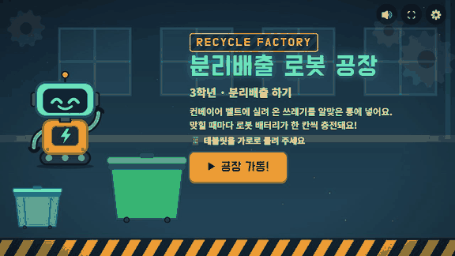
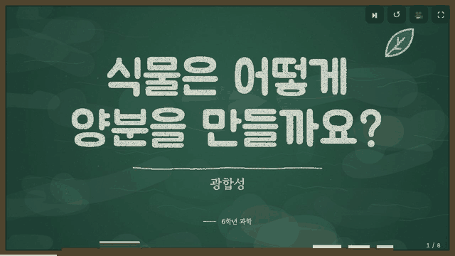
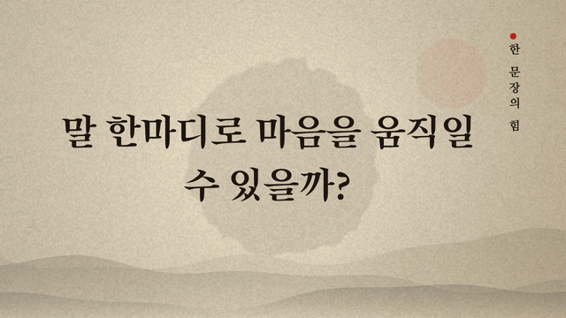
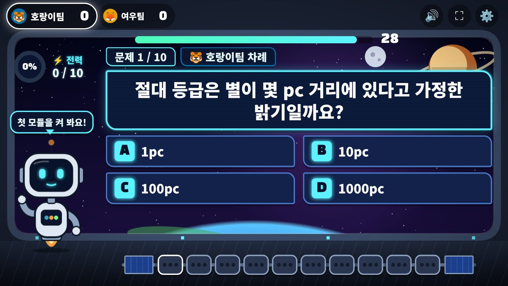
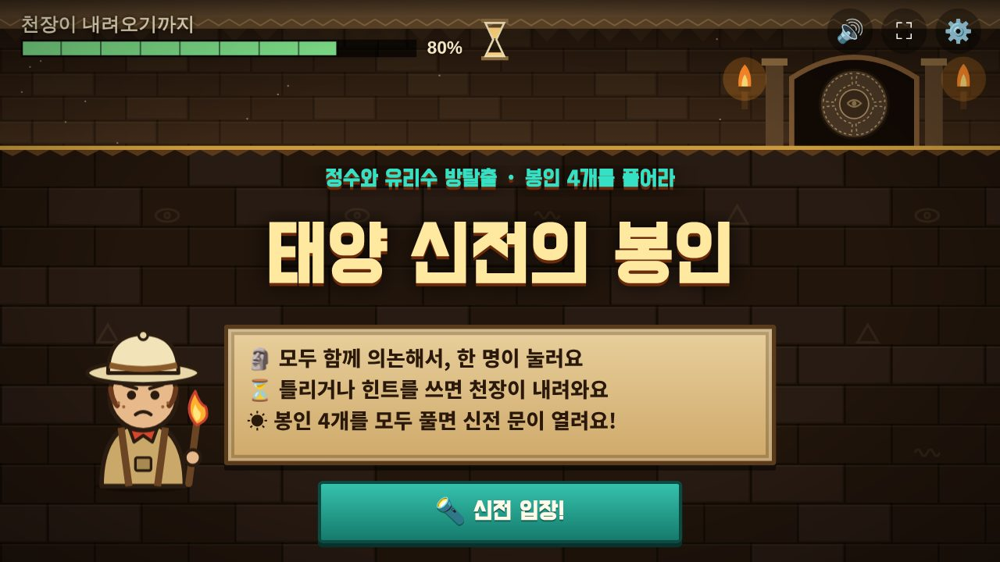
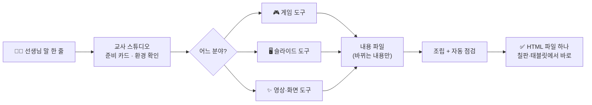

<div align="center">

<picture>
  <source media="(prefers-color-scheme: dark)" srcset="docs/assets/banner-dark.svg">
  
</picture>

<p>
  
  
  
  
  
  
</p>

<a href="README.en.md">English</a> · 한국어

**AI에게 말 한 줄만 하세요. 전문가 이상의 결과가 나와요.**

짧은 요청을 **전문가가 만든 것 같은 품질**로 바꿔 주는 Claude·Codex용 스킬 묶음이에요. AI가 하는 **모든 일**이 대상이에요. 우리가 직접 만든 전용 도구는 **게임 · 슬라이드 · 영상 · 수업 도구 · 자료(엑셀) 분석 · 문서(한글·워드·PDF) · 법률 안내**(스킬 8개)이고, 코딩·웹·보안 점검 같은 일은 **검증된 기존 스킬을 처음 필요할 때 찾아 동의받고 설치**해서 함께 써요. 그 밖에는 AI 자신의 실력 위에 점검 규칙을 얹어요. (자료 조사/비교 전용 도구는 준비 중)

**선생님 맞춤이 기본, 누구나 쓸 수 있어요.** 직업이나 용도로 막지 않아요.

**코딩을 몰라도 됩니다.** 이 스킬(AI에게 주는 작업 설명서와 도구 묶음)을 깔면, Claude·Codex가 안에 든 도구를 꺼내 쓰고 점검까지 마쳐서<br>
짧은 요청에도 **상용 품질 자료**를 **몇 분 만에**, 법을 지키는 범위 안에서 만들어 드려요.

정해진 종류만 만드는 게 아니라 원하는 게임·슬라이드·영상이면 무엇이든 부탁해 보세요. 교실용(큰 칠판 글씨·태블릿 터치·학생 정보 칸 없음)이 기본이고,<br>
가족 영상·결혼식 축사 슬라이드·동호회 퀴즈·가게 홍보 같은 부탁도 용도에 맞게 만들어요. <sub>(한글 문서, PPT 파일, 영상 편집은 준비 중)</sub>

### 요청 한 줄 → 상용 품질 결과물

[시작하기](#-시작하기-주문-한-줄) · [이렇게 말하면, 이렇게 나와요](#-이렇게-말하면-이렇게-나와요) · [어디서 되나요](#-어디서-무엇이-되나요) · [할 수 없는 것](#responsibility) · [이렇게 말해 보세요](docs/prompts.md) · [자주 묻는 질문](#-자주-묻는-질문)

</div>

---

## 👥 누가 쓰나요

선생님 맞춤으로 시작했지만, 만드는 방식은 누구에게나 같아요. 용도·분위기·보는 사람만 알려 주세요.

| 누가 | 이렇게 말해 보세요 |
|---|---|
| 👩‍🏫 선생님 | 「5학년 과학 태양계 퀴즈쇼 만들어 줘」 |
| 💼 직장인 | 「팀 워크숍 오프닝 슬라이드 6장, 깔끔하게」 |
| 🏪 자영업자 | 「우리 카페 신메뉴 소개 영상, 따뜻한 느낌으로」 |
| 🎓 학생 | 「동아리 발표 슬라이드 만들어 줘」 <sub>(Claude는 만 18세 이상만 쓸 수 있어요 — 서비스 이용 기준을 확인해 주세요)</sub> |
| 🧑‍💻 개발자·데이터 분석가 | 「이 기능 테스트부터 짜고 구현해 줘」 · 「이 CSV 정리해서 요약해 줘」 <sub>(코딩은 검증된 기존 스킬과 AI 실력으로, CSV·엑셀 분석은 `teacher-data`가 AI가 원본을 읽지 않고 집계해 그래프 보고서로 만들어요)</sub> |
| 🎬 크리에이터 | 「구독자 1만 명 기념 퀴즈 게임, 화려하게」 |

<details>
<summary><b>지금 들어 있는 기능</b></summary>

- 🎮 **게임**: 7가지 방식(퀴즈·서바이벌·방탈출·짝 맞추기·빙고·말판·분류), 요청에 맞는 자동 테마, 정답·축하 연출과 효과음을 더하는 Wow 키트
- 🖥 **슬라이드**: 목적·분위기에 맞춰 짜는 방식으로 개편 중
- ✨ **영상·화면**: 과목 소개·수업 시작 화면, MP4 저장
- 📄 **문서**: 공문·가정통신문·안내문·보고서를 한글(HWPX)·워드·PDF로, 받은 양식 채우기·한글 파일 고치기·PDF 합치기 (공문 형식 자동 점검)
- ⚖️ **법률 안내**: 공식 출처에서 최신 법을 찾아 근거와 함께
- 🧰 **수업 도구**(타이머·번호 뽑기·모둠·대진표·점수판): 저장소에 들어 있어요(설치 ZIP 묶음에는 아직 없어요)
- 🎞 **영상 눈(video_eyes)**: 내 컴퓨터 안에서만 영상의 장면·자막을 읽어요
- 🧭 **방향 먼저 보여 주기**: 모호한 요청이면 질문 전에 방향 3가지(추천 표시)와 분위기 미리보기 카드를 먼저 보여 주고, 질문은 한 번만(최대 5개, 추천 답 포함, 「네」면 전부 수락). 「알아서」면 바로 만들어요. 기획·조사·분석은 「같이 기획」 한 장 초안으로요
- 🎬 **제작 공정표**: 무엇을 만들든 같은 순서예요. 기획 → 대본 → 콘티 → 제작 → 수정 → 배포. 중간에 「이렇게 가도 될까요?」는 최대 3번만 묻고(「네」면 계속), 작고 분명한 일(타이머 등)은 단계를 건너뛰고, 「알아서」면 쭉 만들어요. 콘티는 한 장짜리 그림 순서표로, 배포는 크기·폰/TV·인쇄·개인정보 확인·출처를 한 번에 정리해 드려요 (대신 올리거나 보내지는 않아요)
- 🔎 **스킬 찾기**: 우리 도구에 없는 일은 기존 스킬을 찾아 (저장소·라이선스·최근 업데이트·위험한 설치 문구를 확인한 뒤) 동의받은 뒤에만 설치하고, 쓴 스킬·자료는 출처 한 줄로 남겨요
- 💻 **코딩·문서·웹·보안 점검**: 전용 도구 대신 추천 목록의 검증된 스킬(Claude 공식 문서 스킬, 웹 지침, 보안 점검 등)을 필요할 때 동의받고 설치. 목록에 없으면 AI 자신의 실력으로 하되 같은 점검 규칙(안 맞으면 물러서기, 2번 고쳐 보기)을 따라요
- ⚙️ **첫 설정**: 학교급·과목·기기를 한 번만 물어 내 컴퓨터에 기억해요 · Claude Code는 플러그인 설치도 돼요
</details>

## 🎨 내 양식대로

디자인의 기준은 **내가 원하는 모양**이에요. 우리 학교·회사 양식, 쓰던 템플릿, 참고 사진·영상이 있으면 **그걸 먼저 따라** 만들어요. 로고·색·글씨 느낌을 알려 주면 그에 맞춰요. 우리 디자인 세트는 아무것도 없을 때 쓰는 **바탕(기본값)**일 뿐이에요.

```text
이 파일(우리 회사 발표 양식) 느낌 그대로 슬라이드 만들어 줘.
이 사진 색감으로 우리 반 퀴즈쇼 꾸며 줘.
```

> [!NOTE]
> 올린 양식·참고 자료의 저작권과 상표는 내가 써도 되는 것인지 확인해 주세요. 파일 자체를 그대로 옮겨 주는 변환이 아니라, 그 느낌을 참고해 새로 만들어요.

---

## ✨ 어떻게 이렇게 되나요

| 1️⃣ 선생님이 짧게 말해요 | 2️⃣ AI가 설명서를 읽고 도구로 만들어요 | 3️⃣ 점검을 통과한 것만 드려요 |
|---|---|---|
| 「5학년 과학 태양계 퀴즈쇼 만들어 줘」처럼 평소 말투 그대로, 한 줄이면 돼요. | 설치된 스킬이 「이런 요청엔 이 도구」를 알려 줘요. AI는 처음부터 짜지 않고 **미리 시험해 둔 도구로 바로 조립**해요. | 오래된 학교 크롬에서 생기는 오류·글자 겹침·학생 정보 칸을 **자동 점검**하고, 통과한 결과만 화면에 띄워 드려요. |

---

## 💬 이렇게 말하면, 이렇게 나와요

아래는 **한 줄 요청을 받아 실제로 만든 결과**를 그대로 녹화한 거예요. 요청 문장과 만든 방법은 [docs/examples.md](docs/examples.md)에 모두 적어 두었어요.

<table>
<tr>
<td width="50%">

> **「5학년 과학 태양계 퀴즈쇼 만들어 줘」**


<sub>🎮 로봇 진행자 · 모둠 점수 · 정답마다 정거장 불이 켜지고 마지막엔 워프 · 해설 포함 6문제</sub>

</td>
<td width="50%">

> **「3학년 분리배출 게임 만들어 줘, 태블릿으로」**



<sub>🎮 끌어서 분류하는 공장 · 정답마다 로봇 배터리 충전 · 10개 물건 · 해설 카드</sub>

</td>
</tr>
<tr>
<td>

> **「6학년 과학 광합성 수업 슬라이드 만들어 줘」**



<sub>🖥 글씨가 칠판에 써지는 8장 · 카드·단계·정답 공개 퀴즈 · 선생님 메모 · PDF 인쇄</sub>

</td>
<td>

> **「1학년 영어 과목 소개 영상 만들어 줘, 뉴스처럼」**


<sub>✨ 뉴스 속보 방송 스타일 약 44초 영상 · MP4로도 저장 (여기선 하이라이트만)</sub>

</td>
</tr>
<tr>
<td>

> **「수업 시작할 때 띄울 화면 만들어 줘, 오늘은 분수의 덧셈」**


<sub>⏱ 카운트다운 5→1 · 오늘의 주제와 목표 · 누르면 「수업 시작!」</sub>

</td>
<td valign="middle">

**📋 요청·내용 전체 기록**

위 5개를 만든 요청 문장, 내용 파일, 점검 결과(모두 통과)와 다시 만드는 명령을 모아 두었어요.

→ [docs/examples.md](docs/examples.md)

</td>
</tr>
</table>

> [!NOTE]
> 문제와 설명은 AI가 쓴 초안이에요. 수업에 쓰기 전에 한 번 확인해 주세요. 용량 때문에 GIF는 핵심 장면만 보여 드려요.

<details>
<summary><b>🎨 다른 디자인 더 보기</b></summary>

&nbsp;

<table>
<tr>
<td width="50%"><br><sub><b>🎮 퀴즈쇼</b> · 방송국 — 진행자·박수 전광판·팀 단상</sub></td>
<td width="50%"><br><sub><b>✨ 과목 소개 영상</b> · 과학 네온 — MP4로도 저장</sub></td>
</tr>
<tr>
<td><br><sub><b>🖥 수업 슬라이드</b> · 키노트형 — 한 줄씩 등장·퀴즈 공개</sub></td>
<td><br><sub><b>✨ 과목 소개 영상</b> · 국어 붓글씨 — 먹 번짐·낙관</sub></td>
</tr>
<tr>
<td colspan="2"><br><sub><b>⏱ 수업 시작 화면</b> · 팝 — 색이 확 바뀌는 카운트다운</sub></td>
</tr>
</table>

**게임 9종 (퀴즈쇼 · 방탈출 · 끌어서 보내기, 각 3가지 디자인)**

| 퀴즈쇼 | 방탈출 | 끌어서 보내기 |
|---|---|---|
| <br><sub>방송국</sub> | <br><sub>거북선 작전실</sub> | <br><sub>달밤 우체국 (영어 발음)</sub> |
| <br><sub>강당 종 울리기</sub> | <br><sub>해독제 실험실</sub> | <br><sub>세포 먹이 주기</sub> |
| <br><sub>우주 정거장</sub> | <br><sub>태양 신전</sub> | <br><sub>분리수거 로봇</sub> |

</details>

---

## 🚀 시작하기 (주문 한 줄)

> [!TIP]
> 아래 문장을 **복사해서 붙여 넣기만** 하면 AI가 알아서 설치하고, 끝나면 「준비 완료」 안내와 메뉴를 보여 드려요.

### 설치 방법 4단계 — 위에서부터 해 보세요
1. **링크 한 줄**: Claude Code · Claude 데스크톱 앱의 Cowork·Code 탭 · Codex 앱에 「https://github.com/zln02/teacher-studio 이 스킬 설치해 줘」 (일반 Chat 탭은 링크로 설치가 안 돼요 → 3번)
2. **명령 한 줄**: `npx skills add zln02/teacher-studio` (스킬 8개 모두 선택) · Claude Code는 `/plugin install teacher-studio --marketplace zln02/teacher-studio`
3. **파일 올리기**: Claude 앱 Chat → [`dist/`](dist/)의 ZIP 8개를 Customize → Skills에 올리기
4. **폴더 복사**: ZIP으로 내려받아 `skills` 안 `teacher-` 폴더 8개를 `.claude/skills`(Claude Code) 또는 `.agents/skills`(Codex)에 복사

자세한 설명은 [INSTALL.md](INSTALL.md). 아래는 1번의 자세한 형태입니다.

<details open>
<summary><b>💻 Claude Code 또는 Codex를 쓰는 경우</b> (권장)</summary>

```text
https://github.com/zln02/teacher-studio 의 INSTALL.md를 읽고 그대로 설치해 줘. 나는 선생님이고 코딩은 몰라.
```

설치가 끝나면 새 대화에서 **「교사 스튜디오 시작」** 이라고 말하거나, 만들고 싶은 걸 바로 말하세요.
</details>

<details>
<summary><b>🧭 앱별 설치 길 한눈에</b> (2026-11-19 검색 요약 기준 · <i>연수 전 실제 화면 확인 필요</i>)</summary>

| 쓰는 곳 | 방법 | 알아 둘 점 |
|---|---|---|
| Claude 데스크톱 · Cowork / Code 탭 | 「내가 준 링크에 하네스 세팅해 줘」, 또는 Customize → Plugins → Add marketplace → `zln02/teacher-studio` | Cowork·플러그인은 유료(Pro 이상). Team·Enterprise는 관리자가 켜야 해요 |
| Claude Chat 탭 | 링크로는 안 돼요. ZIP 8개를 Customize → Skills에 올리고, Settings → Capabilities에서 코드 실행 켜기 | 제일 제한이 많아요 |
| ChatGPT 개인 계정 | **Codex 앱**: 스킬 폴더 `~/.agents/skills`, skill-installer에 GitHub 폴더 주소, 또는 플러그인 | 일반 ChatGPT 화면에는 개인용 설치가 없어요 |
| ChatGPT Business·Enterprise·Edu | Skills 파일 업로드 | 관리자가 허용해야 해요 |
| Gemini 앱 | SKILL.md 형식 Skills 업로드 (2026-10부터) | 도구(스크립트)를 못 돌리면 결과가 제한적이에요 |
| Gemini CLI | `gemini skills install https://github.com/zln02/teacher-studio` | 개발자용 |
</details>

<details>
<summary><b>💬 Claude 앱 Chat(claude.ai)을 쓰는 경우</b></summary>

1. 이 페이지의 [`dist/`](dist/) 폴더에서 ZIP 파일(묶음 파일) 8개를 받습니다: `teacher-studio` · `teacher-game` · `teacher-slides` · `teacher-motion` · `teacher-law` · `teacher-class-tools` · `teacher-data` · `teacher-docs`
2. Claude 앱 → **Customize(맞춤 설정) → Skills** 에서 ZIP을 하나씩 올립니다. (메뉴 이름은 앱 버전에 따라 조금 다를 수 있어요)
3. **설정 → Capabilities** 에서 코드 실행(AI가 도구를 직접 돌리는 기능)·파일 만들기가 켜져 있는지 확인합니다. (기본은 켜짐)
4. 새 대화에서 **「교사 스튜디오 시작」** 이라고 말합니다.
</details>

### 💬 설치 후 첫 화면

```text
🎉 교사 스튜디오 준비 완료!
· 지금 쓰는 곳: Claude Code          · 결과 보기: 크롬 창으로 자동으로 열어요
· 영상: MP4 영상 파일까지 바로 만들어요   · 나누기: 학교 드라이브·USB로 / 링크는 Claude 앱 '게시'

무엇을 만들까요? 번호나 말로 편하게 말씀해 주세요.
1. 🎮 수업 게임 — 퀴즈쇼·종 울리기 / 방탈출 / 끌어서 보내기(단어·분류)
2. 🖥 수업 슬라이드 — 칠판 / 깔끔한 발표 / 파스텔 노트
3. ✨ 과목 소개 영상 — 첫 시간에 틀 30~40초 영상
4. ⏱ 수업 시작 화면 — 카운트다운 + 오늘의 주제
5. 💬 그냥 말로 할게요 (예: 「중2 과학 빛과 파동 방탈출, 칠판용」)
```

이미 원하는 걸 말했다면 메뉴 없이 바로 만들고, **이 환경에서 안 되는 기능이 있으면 한 줄로 먼저 알려 드려요.**

---

## ✨ 그냥 채팅과 무엇이 다른가요

| | 그냥 AI | 교사 스튜디오를 깐 AI |
|---|---|---|
| 시작점 | 빈 화면에서 처음부터 | 원하는 품질 바로 옆에서 시작 |
| 필요한 프로그램 | 이름 찾고, 설치하다 막히고, 다시 묻기 | AI가 알아서 확인하고, 물어본 뒤 설치해서 연결 |
| 디자인 | 「더 예쁘게」를 열 번 | 첫 판부터 어울리는 색·글씨·움직임 |
| 실수 | 깨진 결과를 받고 다시 고치기 | 점검을 통과한 것만 받음 |
| 법 문제 | 모르고 지나치거나 따로 검색 | 걸리는 부분을 근거와 함께 한 줄로 |
| 시간·사용량 | 고치고 찾기를 반복하느라 낭비 | 한두 번이면 끝 — 무료 요금제로도 넉넉하게 |

---

## 🧰 안에 무엇이 들어 있나요

<details>
<summary><b>🧰 지금 바로 만들 수 있는 것 (펼쳐서 보기)</b></summary>

| 분야 | 만들 수 있는 것 | 고를 수 있는 디자인 | 이럴 때 |
|---|---|---|---|
| 🎮 수업 게임 | **퀴즈쇼** | 방송국 · 강당 종 울리기 · 우주 정거장 | 퀴즈·OX·종 울리기, 칠판 모둠전 |
| | **방탈출** | 거북선 작전실 · 해독제 실험실 · 태양 신전 | 단원 마무리, 반 전체 협동 (3~6단계) |
| | **끌어서 보내기** | 달밤 우체국 · 세포 먹이 · 분리수거 로봇 | 단어 뜻, 분류, 짝 맞추기, 태블릿 |
| 🖥 슬라이드 | **짧은 JSON → 디자인된 발표** (13 스타일 × 장 23종, QR·타이머·그래프·수식·표, 편집되는 PPT) | 용도 4가지: 수업·홍보·기관 보고·개인 | 수업·연수·설명회·회사·모임 |
| 📄 문서 | **공문·가정통신문·안내문·보고서** (한글 HWPX·워드·PDF) | 공문 형식(1. 가. 1) …·끝·붙임·날짜) 자동, 양식 채우기·원본 서식 유지 고치기 | 교무 업무, 학부모 안내, PDF 정리 |
| 🧰 수업 도구 | **타이머 · 뽑기 · 모둠 · 대진표 · 점수판** | 오프라인 HTML 1개 | 교실, 가족·동호회 |
| 📊 자료 분석 | **엑셀·CSV → 쉬운 그래프 보고서** | 점수·설문·가계부·매출 | 이름은 가리고 숫자는 대조 |
| ✨ 영상·화면 | **과목 소개 영상** | 과학 네온 · 국어 붓글씨 · 영어 뉴스 | 첫 시간, 과목 홍보 |
| | **수업 시작 화면** | 팝 · 종이 | 집중시키기, 오늘의 주제 |
| ⚖️ 법률 안내 | **「이거 써도 돼요?」 답 카드** | 저작권·개인정보·AI 규정·생기부 | 그때그때 공식 출처에서 최신 법을 찾아 근거 링크와 함께 |

> [!NOTE]
> 디자인은 출발점일 뿐이에요. **어디에 쓸지, 어떤 느낌인지, 참고 사진·영상**을 주시면 색·글씨·속도를 그 느낌으로 바꿔 만들어요.
> 목록에 없는 요청도 같은 부품과 자동 점검으로 직접 만들어 드려요 (조금 더 걸려요).

**준비 중** 📄 가정통신문·공문(한글) · 📊 PPT 파일 · 🎬 영상 편집(자르기·자막·사진 영상) · 📝 학습지 · 🔎 자료 조사 → [로드맵](#-로드맵)

</details>

---

## ✅ 어디서 무엇이 되나요

| | Claude 앱·웹 | Claude Code | Codex |
|---|---|---|---|
| 설치 | Chat은 설정에서 ZIP 8개 올리기 (Cowork·Code 탭은 링크 한 줄) | 설치 한 줄 → `~/.claude/skills` | 설치 한 줄 → `~/.agents/skills` |
| 만들기 + 자동 점검 | ✅ 코드 실행(AI가 도구를 직접 돌리는 기능) 켜기 | ✅ | ✅ |
| 결과 받는 법 | 오른쪽 미리보기·다운로드 (클라우드에서 만들어 내 컴퓨터 폴더에는 직접 못 써요) | 내 컴퓨터에 파일로 저장, 크롬 자동 열기 | 내 컴퓨터에 파일로 저장, 크롬 열기 |
| 공유 링크·QR | ✅ 「게시」 | ➖ 파일로 전달 | ➖ 파일로 전달 |
| 영상 파일 | 🎥 크롬 녹화(.webm) — 인터넷이 제한돼 MP4 변환 도구(ffmpeg)는 안 될 가능성이 커요 | ✅ MP4 (처음 요청할 때 영상 도구(ffmpeg) 설치, 약 150MB) | ✅ MP4 (처음 요청할 때 설치, 인터넷 허용 필요) |
| 법률 안내 최신 확인 | ✅ 웹 검색 켜기 | ✅ 기본 내장 | ⚠️ 「live」 웹 검색 필요 |
| 무료 요금제 | 스킬·코드 실행은 무료에서도 된다고 안내돼 있어요 (Cowork·플러그인은 유료 Pro+, *연수 전 확인 필요*) | 구독 또는 API 키(프로그램 연결용 열쇠) 필요 | ✅ 무료·Go 포함 (한도 비공개) |

> 🧭 **Codex 팁** — 파일을 쓸 때 **승인 창**이 뜨면 허용해 주세요. 인터넷은 기본으로 꺼져 있어서, 최신 법 확인·도구 설치를 하려면 설정 파일(`~/.codex/config.toml`)에서 인터넷을 켜 주어야 해요. 어렵다면 AI에게 「인터넷 켜는 법 알려줘」라고 하면 돼요. (개발자용: `[sandbox_workspace_write]` 아래 `network_access = true`, 웹 검색은 `--search`(live)로 켭니다.)

설치가 끝나면 AI가 **이 표 중 지금 환경에 맞는 줄**을 골라 한 번에 알려 드려요. 「여기서 영상 돼?」처럼 물어봐도 돼요.
(2026-11-18 공식 문서 기준: [Claude 스킬](https://support.claude.com/en/articles/12512180) · [Claude Code 스킬](https://code.claude.com/docs/en/skills) · [Codex 스킬](https://learn.chatgpt.com/docs/build-skills) · [Codex 승인·보안](https://learn.chatgpt.com/docs/agent-approvals-security))

---

## 🗣 이렇게 말해 보세요

```text
중2 과학 「빛과 파동」 방탈출 만들어 줘. 칠판에 띄워서 반 전체가 풀 거야. 긴장감 있게!
중1 영어 단어 12개로 모둠 게임. 단어: apple 사과, library 도서관, …
과학 과목 소개 영상 만들어 줘. 첫 시간에 틀 거고 멋있게. 중학교 1학년.
이 학습지(PDF)로 퀴즈쇼 만들어 줘. 태블릿으로 각자 할 거야.
학부모 설명회 슬라이드 8장. 따뜻한 느낌으로. 이 사진 느낌 참고해 줘.
더 화려하게 / 글씨가 뒤에서 안 보여 / 아까가 나았어
```

더 많은 예시 → **[docs/prompts.md](docs/prompts.md)**

---

## ⚙️ 어떻게 동작하나요



- **미리 시험해 둔 도구**: AI는 게임·화면 코드를 새로 짜지 않고 **내용만** 채워요 → 빠르고, 사용량이 적고, 품질이 일정해요.
- **안에 든 부품**: 게임 틀, 무대 화면, 움직임 효과([anime.js](https://animejs.com)), 효과음, 그림 모음 — 모두 파일 안에 들어가 **설치 없이** 열려요. (글씨체만 보는 기기가 Google에서 받아 와요)
- **품질 장치**: 선생님 말 사전, 교실 크기 기준, 자동 점검(오래된 학교 크롬에서 안 되는 부분·밖에서 불러오는 자료·학생 정보 칸 검사).
- **AI 보조 제작**: 만든 자료는 AI가 도운 초안이에요. 수업·공개 전에 선생님이 꼭 한 번 검토해 주세요.

개발자용 구조 설명(코딩을 아는 분만) → **[docs/how-it-works.md](docs/how-it-works.md)** · 전체 지도 → **[MAP.md](MAP.md)**

---

## 🗺 로드맵

- [x] 게임 3종 × 디자인 9
- [x] 슬라이드 (디자인 3), 과목 소개 영상·수업 시작 화면 (디자인 5)
- [x] 설치 한 줄 + 준비 카드 + 환경 확인
- [ ] 📄 가정통신문·공문 (한글 파일(HWPX), 공문 규칙 자동 점검)
- [ ] 🎬 영상 편집 (사진 슬라이드쇼·자르기·자막·세로 숏폼)
- [ ] 📊 PPT 파일 (한글 글꼴 깨짐 방지)
- [ ] 🧰 수업 도구 (타이머·번호 뽑기·모둠 나누기·자리 바꾸기)
- [ ] 🎮 게임 추가 (보드게임·타워 디펜스·탐험 지도)
- [ ] 🖼 참고 사진·영상 → 새 디자인 자동 만들기

원하는 기능이 있으면 [요청하기](../../issues/new/choose)로 알려 주세요.

---

## ❓ 자주 묻는 질문

<details><summary><b>무료 계정으로도 되나요?</b></summary>

네. 결과물(HTML 파일)은 계정 없이 누구나 열 수 있어요. 만드는 쪽은 (2026-11-18 확인)
- **Claude**: Chat에서 ZIP으로 올리는 스킬과 코드 실행은 무료 요금제에서도 쓸 수 있다고 안내돼 있어요(연수 전 실제 화면 확인 필요). Cowork·플러그인(링크 한 줄 설치)은 유료(Pro 이상)이고 Team·Enterprise는 관리자가 켜야 해요 ([스킬 안내](https://support.claude.com/en/articles/12512180) · [파일 만들기](https://support.claude.com/en/articles/12111783-create-and-edit-files-with-claude)).
- **ChatGPT(Codex 앱)**: 개인 계정은 Codex 앱에서 써요. 무료·Go 요금제에 포함돼요(연수 전 확인 필요). 일반 ChatGPT의 Skills는 Business·Enterprise·Edu만, 관리자가 허용해야 해요. 사용 한도는 공개돼 있지 않아요 ([요금 안내](https://learn.chatgpt.com/docs/pricing)).

사용량이 한정된 걸 생각해서, 이 스튜디오는 **미리 시험해 둔 도구에 내용만 넣는 방식**으로 사용량을 크게 줄였어요.
</details>

<details><summary><b>인터넷이 안 되는 교실에서도 열리나요?</b></summary>

네. 결과물은 **HTML 파일 하나**라서 크롬만 있으면 열려요. 다만 예쁜 한글 글씨체는 보는 기기가 열 때 Google에 접속해 받아 와요. 인터넷이 없으면 기본 글씨체로 열려요. USB나 학교 드라이브에 넣어 두세요.
</details>

<details><summary><b>학생 이름이나 점수가 저장되나요?</b></summary>

아니요. 학생 이름·학번·사진을 넣는 칸이나 기록을 저장하는 기능은 **만들지 않도록** 규칙이 들어 있어요. 팀 이름은 동물 이름이 기본이에요.
</details>

<details><summary><b>노래·글씨체·사진을 넣어도 되나요?</b></summary>

선생님이 올린 자료는 그대로 넣어 드리고, 필요하면 저작권 안내를 한 줄 붙여요 (막지 않아요). 수업 안 사용과 학교 밖 공개는 기준이 다를 수 있어요.
</details>

<details><summary><b>오래된 전자칠판에서도 되나요?</b></summary>

오래된 크롬에서 안 되는 부분을 자동 점검이 걸러요. 화면이 버벅이면 저절로 가벼운 모드로 바뀌어요.
</details>

<details><summary><b>다른 선생님께 나눠 줄 수 있나요?</b></summary>

Claude 앱에서는 「게시」로 링크·QR을, 그 밖에는 HTML 파일을 그대로 보내면 돼요. 받은 선생님도 자기 AI에 올려 고칠 수 있어요.
</details>

---

<a id="responsibility"></a>

## ⚖️ 할 수 없는 것 · 책임은 선생님께

- **학생 개인정보**: 이름·학번·사진·성적을 넣는 칸을 만들거나 저장하지 않아요. 학생 이름·성적·상담 내용은 채팅에 붙여 넣지 말고 가명으로 바꿔 주세요.
- **학생이 AI를 직접 쓰는 흐름은 만들지 않아요.** Claude는 만 18세 이상만 쓸 수 있어요 ([연령 기준](https://support.claude.com/en/articles/13117299-minimum-age-requirement-access-restriction)).
- **실제 방송·캐릭터·브랜드는 흉내 내지 않아요.** 비슷한 분위기의 오리지널로 만들어요.
- **남의 그림·글·음악이 든 자료**는 공개 링크로 올리기 전에 한 번 확인해 주세요.
- **평가·생기부 문구**는 AI가 확정하지 않아요. 선생님이 직접 검토·확정해 주세요.
- **확인하지 못한 사실은 지어내지 않아요.** 통계·인용·법 조문 같은 사실은 빼고 마지막 안내에 알려요. 선생님만 아는 값(날짜·장소·비용)은 그럴듯한 예시로 채우고, 파일에 한 줄 표시한 뒤 마지막 안내에 「바꿔 넣을 곳」으로 모두 적어 드려요. 손으로 쓰는 회신서·신청서 칸만 빈칸이에요.

**법률 문제는 ⚖️ 법률 안내에 물어보세요.** 그때그때 공식 출처(국가법령정보센터 등)에서 최신 법을 찾아 근거 링크와 함께 알려 드려요. 법률 자문이 아니며 최종 판단과 책임은 선생님께 있어요.

**그 밖에**: 어디서든 [Agent Skills](https://agentskills.io) 표준(AI 도구들이 함께 쓰는 스킬 규격, SKILL.md)으로 동작해요 — Claude·Codex 등 같은 폴더.

## 🤝 함께 만들기

- 💡 [기능 요청](../../issues/new?template=request.yml) — 선생님 말로 적어 주세요
- 🐞 [안 되는 부분 알리기](../../issues/new?template=bug.yml) — 캡처 한 장이면 충분해요
- 🛠 개발 참여: [docs/how-it-works.md](docs/how-it-works.md) · [CHANGELOG](CHANGELOG.md)

## 👤 만든 사람

박진영 ([zln02](https://github.com/zln02))

이 이름과 배너는 원작자 허락 없이 원본처럼 쓸 수 없어요 (Apache-2.0 제6조 — 상표 사용권은 주지 않아요).

## 📜 라이선스·고마운 분들

- 코드: [Apache-2.0](LICENSE) · 제3자 고지: [NOTICE](NOTICE)
- [anime.js](https://github.com/juliangarnier/anime) (MIT) · [Kenney](https://kenney.nl) 그림·소리 (CC0) · 글씨체: Google Fonts (OFL, 열 때 불러옴)

<div align="center"><sub>Anthropic·OpenAI와 제휴하지 않은 비공식 오픈소스 프로젝트예요.<br>대한민국 선생님들을 위해 · Made with Claude</sub></div>
