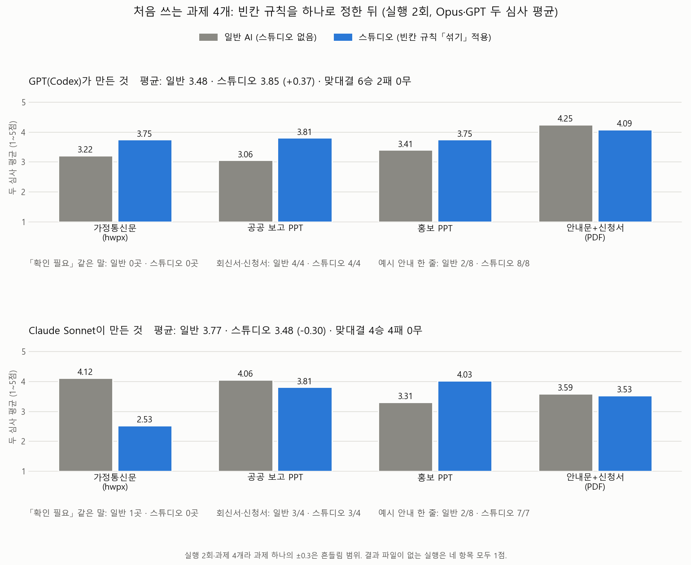

# 빈칸 규칙을 「섞기」 하나로 정하고 처음 쓰는 과제로 다시 잰 결과 (2026-11-21)

앞 문서: [`cross-vendor-fix-2026-11.md`](cross-vendor-fix-2026-11.md) (「확인 필요 · 교사 초안」 규칙은 소유자 결정을 기다리며 그대로 두었다). 소유자가 고른 방식은 그 문서의 안 3, 「섞기」다.

## 결론 먼저

- **GPT(Codex)는 스튜디오를 붙인 쪽이 이겼다.** 일반 3.48 대 스튜디오 3.85 (+0.37), 맞대결 6승 2패. 두 심사(Opus +0.47, GPT +0.27) 모두 같은 방향이다. 지난 측정에서 지던 가정통신문(+0.53)과 공공 보고 PPT(+0.75)가 이기는 쪽으로 바뀌었다.
- **Claude는 평균이 내려갔다(3.77 → 3.48, -0.30). 실행 하나가 파일을 못 냈기 때문이다.** 가정통신문 2회차에서 Claude가 Python을 전체 경로로 불렀고, 측정용 허용 목록이 그 명령을 막아 파일 없이 끝났다(네 항목 1점). 이 실행을 빼면 3.72 대 3.83 (+0.11), 4승 3패다. 빈칸 규칙 때문이 아니라 측정 환경의 제한 때문이지만, 다시 돌리지 않고 그대로 실었다.
- **「확인 필요」「교사 초안」은 스튜디오 결과물 15개에서 0번이었다.** 지난 측정에서는 GPT 보고 PPT 한 파일에 「확인 필요」가 45번, 가정통신문 네 번 모두에 「교사 초안」이 찍혔다.
- **회신서·신청서는 빠지지 않았다.** 스튜디오 쪽은 파일이 나온 7개 모두에 있다(GPT 4/4, Claude 3/3). 지난 측정의 GPT 가정통신문은 네 번 모두 회신서가 없었다.
- **예시 안내 한 줄은 15개 중 13개가 정확히 한 번이다.** 나머지 둘은 GPT의 공공 보고 PPT로, 자료 장마다 출처 줄에 「자료: 가상 …」「자료: 예시 …」를 적었다(7~8장 반복). 규칙이 금지한 「장마다 표시」다. 점검기가 이 꼴을 못 잡아서 측정 뒤에 잡도록 고쳤다.
- **마지막 안내에 「바꿔 넣을 곳」 목록이 15개 모두 있다.** 일반 AI는 Claude 6/8, GPT 1/8이다.
- **아직 지는 과제:** GPT의 PDF 안내문+신청서(-0.16), Claude의 공공 보고 PPT(-0.25)와 PDF(-0.06). 셋 다 ±0.3 안쪽이라 차이로 읽기 어렵다.
- 과제 4개·실행 2회다. 과제 하나의 ±0.3은 실행 하나로 뒤집힌다.

## 정한 규칙 (어디서나 같은 한 가지)

`shared/content/CONTENT-RULES.md`의 「Unknowns」 절. 사용자가 준 사실은 그대로 쓰고, 주지 않은 것에만 적용한다.

1. 본문·표·일정·보고 수치·슬라이드: 그럴듯한 예시 값으로 채운다(요일이 맞는 실제 날짜, 장소, 금액). 사람 이름은 「담임 교사」 같은 역할로 쓰고 지어낸 실명은 쓰지 않는다. 칸에 「확인 필요」「집계 필요」「미정」을 쓰지 않는다.
2. 손으로 쓰는 곳만 빈칸: 회신서·신청서·동의서, 서명란, 학생·보호자 칸. 가정에서 답해야 하는 가정통신문은 회신서를 꼭 둔다.
3. 예시 안내는 파일마다 정확히 한 줄. 문서는 본문 맨 아래, 보고·홍보 PPT는 첫 장 발표자 메모(보고는 첫 자료 표 아래 한 줄도 됨). 수업 PPT는 그냥 채우고 안내를 넣지 않는다. 파일 안에 「교사 초안」 도장은 찍지 않는다.
4. 마지막 안내에 예시로 채운 값을 모두 적는다(spec의 `fillins` 목록).
5. 사용자가 「빈칸으로 둬」라고 하거나 자기 양식을 주면 그 말이 먼저다.

통계·인용·법 조문·정답·안전 조건 같은 세상의 사실은 이 규칙의 대상이 아니다. 확인하지 못하면 빼고 마지막 안내에 알린다. 법률 답변은 `teacher-law`의 표현을 그대로 둔다.

### 고친 문장

| 파일 | 전 | 뒤 |
|---|---|---|
| `shared/content/CONTENT-RULES.md` 4번 규칙 | 모든 사실은 (a) 사용자 자료 (b) 확인한 출처 (c) 「확인 필요」 표시 | 세상의 사실은 확인하거나 뺀다. 사용자만 아는 값은 예시 값 |
| 같은 파일 「Release status」 절 | 확인 안 된 사실이 있으면 「교사 초안」, 교사용 쪽에 표시 | 절을 없애고 「Unknowns」 절로 바꿈 |
| 같은 파일 G2 | 「확인 필요」가 남으면 교사 초안 | 예시 값, 손으로 쓰는 곳만 빈칸, 빈말·도장 없음 |
| `teacher-docs/references/content-docs.md` 15 · 41 · 57 · 69 · 72 | 「확인 필요」로 표시, 그럴듯한 값으로 채우지 말 것, 「교사 초안」 | 예시 값 + `fillins`, 회신서 안에만 빈칸, 맨 아래 한 줄 |
| `teacher-docs/SKILL.md` | 「알아서」 줄이 「PDF」 절 안에만 있음 | 「What the user did not give (every format)」 절로 옮김. HWPX·Word에도 적용 |
| `teacher-slides/SKILL.md` · `content-slides.md` · `context-recipes.md` | 가상 수치를 쓴 장마다 「예시 자료(가상 수치)」 표시, 불확실하면 「확인 필요」 | 자료 전체에서 한 번(첫 장 발표자 메모), 「확인 필요」 칸 금지 |
| `teacher-studio/SKILL.md` 절대 규칙 2 | 불확실하면 「확인 필요」 표시 | 위 규칙 한 줄 요약 |
| 그 밖 | `content-lesson` · `content-items` · `content-promo` · `content-webapp` · `content-plan` · `content-motion` · `webapp.md` · `pipeline.md` · `user-wins.md` · `README.md`의 「교사 초안」「확인 필요로 표시」 문장 | 같은 규칙을 가리키도록 바꿈 |

`teacher-studio/SKILL.md` 크기 상한 시험은 16000 → 16300바이트로 올렸다(규칙 한 줄이 약 250바이트 늘었다).

### 도구와 점검기

- 문서: spec에 `fillins`가 있으면 `docmodel.py`가 본문 맨 아래에 예시 안내 한 줄을 넣는다(회신서 위). 이미 같은 뜻의 줄이 있거나 `"example_note": false`, `"template_blanks": true`면 넣지 않는다.
- PPT: `deck.py`가 첫 장 발표자 메모에 한 줄을 넣는다. 수업 자료와 양식 모드는 넣지 않는다.
- 두 도구 모두 `fillins` 목록을 「바꿔 넣을 곳」으로 출력해 마지막 안내에 옮겨 적게 한다.
- 새 점검 (`shared/tools/placeholders.py`의 `policy_checks`, `doc_check.py`, `pptx_check.py`):

| 점검 | 결과 |
|---|---|
| 「확인 필요」「집계 필요」「미정」 같은 말 | 1~2곳 WARN, 3곳 이상 FAIL |
| 본문의 「교사 초안」「배포 전 확인」「제출 전 검토본」 | FAIL |
| 예시 값을 썼는데 예시 안내가 없음, 또는 두 번 이상 | WARN |
| 가정통신문이 답을 요구하는데 회신서가 없음 | spec으로 만들 때 FAIL(`"reply": false`로 「답할 것 없음」을 밝히면 통과), 파일만 볼 때 WARN |
| 회신서·신청서 밖 본문의 밑줄 빈칸 | WARN (양식 모드는 제외) |

- 기존 빈칸 점검(`[학교명]`, `○○`, `20XX` FAIL)은 그대로다. 밑줄 빈칸은 회신서·신청서 안에서만 조용히 통과한다.

## 측정 결과

점수는 1~5점, 4항목 평균. 과제마다 네 결과물을 A~D로 가려 Opus와 GPT가 각각 2회(순서 바꿈) 채점했다.

### 만든 AI × 심사

| 만든 AI | 심사 | 일반 평균 | 스튜디오 평균 | 차이 | 일반 최저 실행 | 스튜디오 최저 실행 | 맞대결(승-패-무) |
|---|---|---|---|---|---|---|---|
| GPT(Codex) | Opus | 3.12 | 3.59 | +0.47 | 2.12 | 2.75 | 6-2-0 |
| GPT(Codex) | GPT | 3.84 | 4.11 | +0.27 | 2.75 | 3.12 | 6-2-0 |
| GPT(Codex) | 둘 평균 | 3.48 | 3.85 | +0.37 | 2.44 | 2.94 | 6-2-0 |
| Claude Sonnet | Opus | 4.02 | 3.66 | -0.36 | 3.12 | 1.00 | 4-4-0 |
| Claude Sonnet | GPT | 3.53 | 3.30 | -0.23 | 2.88 | 1.00 | 4-2-2 |
| Claude Sonnet | 둘 평균 | 3.77 | 3.48 | -0.30 | 3.00 | 1.00 | 4-4-0 |
| Claude Sonnet, 파일 없는 실행 제외 (7쌍) | Opus | 3.95 | 4.04 | +0.09 | | 3.38 | 4-3-0 |
| Claude Sonnet, 파일 없는 실행 제외 (7쌍) | GPT | 3.50 | 3.62 | +0.12 | | 3.12 | 4-1-2 |
| Claude Sonnet, 파일 없는 실행 제외 (7쌍) | 둘 평균 | 3.72 | 3.83 | +0.11 | | 3.38 | 4-3-0 |

### 과제별 (일반 → 스튜디오, 괄호는 차이)

| 과제 | 만든 AI | Opus 심사 | GPT 심사 | 둘 평균 | 스튜디오 ≥ 일반? |
|---|---|---|---|---|---|
| 가정통신문(hwpx) | GPT | 2.75 → 3.50 (+0.75) | 3.69 → 4.00 (+0.31) | 3.22 → 3.75 (+0.53) | 예 |
| 가정통신문(hwpx) | Claude | 4.38 → 2.44 (-1.94) | 3.88 → 2.62 (-1.25) | 4.12 → 2.53 (-1.59) | 아니오 (2회차 파일 없음. 1회차는 4.12 → 4.06) |
| 공공 보고 PPT | GPT | 2.69 → 3.44 (+0.75) | 3.44 → 4.19 (+0.75) | 3.06 → 3.81 (+0.75) | 예 |
| 공공 보고 PPT | Claude | 4.38 → 4.25 (-0.12) | 3.75 → 3.38 (-0.38) | 4.06 → 3.81 (-0.25) | 아니오 |
| 홍보 PPT | GPT | 3.06 → 3.62 (+0.56) | 3.75 → 3.88 (+0.12) | 3.41 → 3.75 (+0.34) | 예 |
| 홍보 PPT | Claude | 3.44 → 4.31 (+0.88) | 3.19 → 3.75 (+0.56) | 3.31 → 4.03 (+0.72) | 예 |
| 안내문+신청서(PDF) | GPT | 4.00 → 3.81 (-0.19) | 4.50 → 4.38 (-0.12) | 4.25 → 4.09 (-0.16) | 아니오 |
| 안내문+신청서(PDF) | Claude | 3.88 → 3.62 (-0.25) | 3.31 → 3.44 (+0.12) | 3.59 → 3.53 (-0.06) | 아니오 |

### 항목별 (두 심사 합침)

| 조건 | 내용 | 디자인 | 가독성 | 목적 적합 |
|---|---|---|---|---|
| GPT 일반 | 2.81 | 4.31 | 4.00 | 2.81 |
| GPT 스튜디오 | 3.72 | 4.00 | 4.03 | 3.66 |
| Claude 일반 | 4.06 | 3.84 | 3.66 | 3.53 |
| Claude 스튜디오 (파일 없는 실행 포함) | 3.84 | 3.28 | 3.41 | 3.38 |

GPT는 내용 +0.91, 목적 적합 +0.85가 올랐고 디자인은 -0.31이다. 일반 GPT는 값을 대괄호나 밑줄로 비워 두어 「그대로 배포할 수 없다」는 심사 노트가 되풀이됐다.

### 빈칸 규칙 관련 개수 (결과 파일을 우리 점검기로 셈)

| 조건 | 결과 파일 | 「확인 필요」 같은 말 | 「교사 초안」 도장 | 대괄호·○○ 같은 빈자리 | 회신서·신청서 있음 / 있어야 함 | 예시 안내 있음 | 정확히 한 번 | 화면에 두 번 이상 | 마지막 안내에 바꿀 곳 목록 |
|---|---|---|---|---|---|---|---|---|---|
| Claude 일반 | 8/8 | 1곳 (1개 파일) | 0 | 61곳 | 4/4 | 2 | 0 | 2 | 6 |
| Claude 스튜디오 | 7/8 | 0 | 0 | 0 | 3/3 (1개는 파일 없음) | 7 | 7 | 0 | 7 |
| GPT 일반 | 8/8 | 0 | 0 | 119곳 | 4/4 | 2 | 0 | 0 | 1 |
| GPT 스튜디오 | 8/8 | 0 | 0 | 0 | 4/4 | 8 | 6 | 2 | 8 |

- Claude 일반의 회신서·신청서는 점검기가 3/4로 셌다. 나머지 하나는 신청서가 실제로 있는데 제목 글자를 PDF에서 읽지 못한 경우라 눈으로 확인해 4/4로 적었다. `policy.json`에는 점검기 값(3)이 그대로 있다.
- GPT 스튜디오의 「두 번 이상」 2개는 공공 보고 PPT 두 실행이다. 자료 장의 출처 줄마다 「자료: 가상 …」(1회차) 또는 「자료: 예시 …」(2회차)를 썼다. 측정할 때의 점검기는 이 꼴을 세지 못했고, 측정 뒤 고친 점검기로 다시 센 값이다.
- GPT 일반은 본문 밑줄 빈칸 파일 1개(8곳), 대괄호 자리 119곳(보고 PPT 한 파일에 80곳)이다.

### 시간·비용·점검기

| 조건 | 시간 중앙값 | 시간 평균 | 비용 합(8회) | 파일 나옴 | 점검기 통과 | 실행당 막히거나 실패한 명령 |
|---|---|---|---|---|---|---|
| Claude 일반 | 108초 | 136초 | $3.59 | 8/8 | 0/8 | 5.2 |
| Claude 스튜디오 | 148초 | 141초 | $3.14 | 7/8 | 7/7 | 3.4 |
| GPT 일반 | 232초 | 335초 | 구독 | 8/8 | 3/8 | 1.5 |
| GPT 스튜디오 | 260초 | 258초 | 구독 | 8/8 | 8/8 | 3.6 |

- 점검기는 이번에 고친 것(새 점검 포함)을 모든 조건의 파일에 똑같이 돌렸다. 일반 AI 쪽 FAIL은 주로 대괄호·○○ 빈자리다.
- GPT 스튜디오는 보안 상자 안에서 PDF 두 개를 모두 만들었다. 앞 문서의 「보안 상자 안에서는 PDF를 못 만든다」는 한계가 이번 두 실행에서는 나타나지 않았다. 어떤 길로 만들었는지는 실행 기록을 자세히 확인하지 않았다.
- 시간 초과 없음. 심사 32회(Opus 16회 $4.75, GPT 16회 구독) 모두 정상 응답.

## 아직 지는 곳

1. **Claude 가정통신문 2회차: 파일 없음.** spec은 다 썼다(예시 값, 회신서 포함). Python을 `py`가 아닌 전체 경로로 불렀고 측정용 허용 목록(`py`·`python`·`python3`·`node`로 시작하는 명령만)이 막았다. 허용 목록이 없는 보통 환경에서는 나오지 않을 실패지만 확인하지는 않았다.
2. **GPT PDF (-0.16).** 일반 GPT의 1회차 PDF가 4.75로 이번 32칸 중 가장 높다. 스튜디오 쪽 심사 노트: 「3일 과정이라 내용이 얇다」(일반은 5일 과정표), 「예시 안내 문구가 남아 있어 지우고 써야 한다」. 예시 안내 한 줄이 「바로 쓸 수 있는가」 점수를 조금 깎는다. 소유자가 고른 방식의 값이다.
3. **Claude 공공 보고 PPT (-0.25).** 2회차에서 목차의 「개선 과제 및 다음 계획」 장이 심사 그림에 보이지 않았고 「5개 프로그램」이라 쓰고 표에는 4개였다. 1회차는 급식 인원 576명과 620명이 섞였다. 빈칸 규칙이 아니라 내용 일치 문제다.
4. **GPT 홍보 PPT 2회차 (2.94).** 짙은 녹색 바탕에 작은 검은 글씨. 디자인 문제다.

## 재측정 방법 (재현용)

- `cross-vendor-2026-11/xv_eval.py`를 그대로 불러 쓴다: `blanks-policy-2026-11/bp_eval.py` (`setup` → `run codex|claude bare|harness` → `render` → `judge opus|gpt` → `table` → `collect`). 그림은 `bp_plot.py`, 개수는 `bp_policy.py`.
- 과제 4개(실행 전에 정함, 저장소에 쓰인 적 없는 주제인지 `git grep`으로 확인). 문장 끝에 「알아서 끝까지 만들어 줘. 결과 파일은 지금 폴더에 저장해 줘.」를 붙였다.
  - 가정통신문: 「2학년 스케이트 체험학습 안내 가정통신문을 한글 파일(hwpx)로 만들어 줘」
  - 공공 보고 PPT: 「교육지원청 보고용 '2026학년도 학교 급식 잔반 줄이기 사업 운영 결과' 발표자료 만들어 줘 (파워포인트 파일로)」
  - 홍보 PPT: 「우리 학교 가족 걷기 대회 홍보용 PPT 만들어 줘 (6장, 파워포인트 파일로)」
  - PDF: 「겨울방학 코딩 캠프 참가 안내문과 신청서를 PDF로 만들어 줘」
- 만든 AI: Claude Sonnet, GPT(Codex CLI 0.171.0, `gpt-6.2-sol`, 추론 강도 medium). 조건마다 2회, 빈 폴더, 25분 상한, 한 번에 2개까지, 브라우저는 한 번에 하나.
- 실행 옵션은 앞 두 측정과 같다. 권한·보안 상자 우회 없음. Claude: `claude -p --permission-mode acceptEdits` + 허용 목록 + 설치 명령 거부 목록. Codex: `codex exec -s workspace-write`(인터넷 차단), 격리한 `CODEX_HOME`, `[windows] sandbox = "unelevated"`. Codex 작업 폴더는 `C:\Users\User\Downloads\xv-eval-work\blanks\`에 두고 측정 뒤 지웠다.
- 스킬은 `py scripts/setup.py --agent codex`와 `--agent claude-code`를 임시 홈으로 돌려 설치한 8개 폴더. 소유자의 `~/.claude`, `~/.codex`, `~/.agents`에는 쓰지 않았다.
- PDF 과제에서 안내문과 신청서를 파일 두 개로 저장한 실행(일반 Claude 1, 일반 GPT 1)은 안내문·신청서 순서로 이어 붙여 심사했다. 모든 조건에 같은 규칙이다. 처음 규칙이 일반 Claude 한 실행에서 안내문만 골라, 심사 전에 규칙을 고치고 그 실행만 다시 그렸다.
- 원자료: `blanks-policy-2026-11/table.json`, `policy.json`, `raw/`(실행 32개의 상태·결과 파일·점검 결과, 심사 32회의 점수와 배정표).

## 점검한 것

- `tools/`와 `shared/tools/`의 시험 파일 28개 모두 통과(새 `tools/test_unknowns_policy.py` 19개 포함).
- `py tools/sync_shared.py` 뒤 `--check`: 어긋남 없음.
- 옛 완제품 스킨 17개를 `studio.py fire`로 다시 만들어 `check` 모두 PASS.
- `setup.py --agent claude-code`와 `--agent codex`를 임시 홈에서 실행: 둘 다 성공.

## 한계와 확인하지 못한 것

- 과제 4개·실행 2회·심사 2회씩이다. 평균 ±0.2, 과제 하나 ±0.3은 흔들림 범위로 본다.
- 앞 측정과 과제가 달라 「전과 후」를 같은 과제로 비교한 것이 아니다. 앞 측정의 과제 6개는 다시 돌리지 않았다.
- 문서·PPT만 쟀다. 게임·웹 앱·영상·포스터에는 규칙 글만 바꿨고 측정하지 않았다. HTML 결과물에는 새 점검(빈말·도장·예시 안내)을 붙이지 않았다.
- 예시 안내 한 줄과 「바꿔 넣을 곳」 목록이 있어도 예시 날짜·금액이 그대로 나갈 위험은 남는다. 실제 교사가 목록을 보고 고치는지는 재지 않았다.
- 「사용자가 준 사실은 그대로 쓴다」와 「빈칸으로 둬」는 시험 파일로만 확인했다. 이번 과제 4개는 모두 사실을 주지 않은 요청이다.
- GPT가 출처 줄마다 「가상 …」「예시 …」를 쓰는 것은 점검기만 고쳤다(WARN). 고친 뒤 GPT로 다시 만들어 보지 않았다.
- 회신서 점검은 낱말로 판단한다(「동의」「신청」「참가비」 등). 답할 것이 없는 알림에 FAIL이 나면 `"reply": false`로 넘긴다. 손으로 만든 파일에서는 제목 글자가 그림이면 회신서를 못 찾는다(이번에 1건).
- Claude 실행 하나가 허용 목록에 막힌 것이 보통 환경에서도 생기는지 확인하지 않았다.
- PPT와 hwpx 심사 그림은 앞 측정과 같은 근사 그림이다. 발표자 메모는 심사 그림에 보이지 않는다.
- Codex 보안 상자의 `elevated` 방식, macOS·Linux는 확인하지 못했다.
