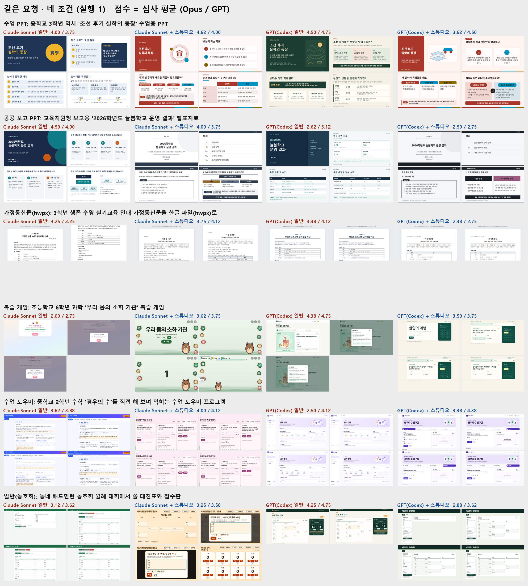

# 교사 스튜디오는 Claude 말고 GPT에서도 도움이 되는가 (2026-11-21)

## 결론 먼저

- **「모든 과제에서 스튜디오 ≥ 일반 AI」 원칙은 이번 측정에서 지켜지지 않았다.** 과제 6개 × 만든 쪽 2곳 = 12칸 중 스튜디오가 같거나 나은 칸은 **3칸**뿐이다 (Claude 2칸, GPT 1칸).
- **Claude Sonnet: 비겼다.** 두 심사 평균 3.67 대 3.67. 게임(+0.72)과 동호회 도구(+0.34)는 이겼고, 수업 도우미(-0.62)·가정통신문(-0.19)·PPT 둘(-0.09, -0.12)은 졌다.
- **GPT(Codex): 스튜디오를 붙이면 오히려 내려갔다.** 3.80 → 3.40 (-0.40). 6개 과제 중 5개에서 졌고, 맞대결은 12번 중 3승 9패다. 이긴 곳은 수업 도우미(+0.38) 하나다.
- **GPT가 지는 가장 큰 이유는 스튜디오의 「모르는 값은 확인 필요로 두고 교사 초안으로 표시」 규칙을 글자 그대로 지켰기 때문이다.** 가정통신문에 「교사 초안·배포 전 확인」이 찍히고 회신서가 빠졌으며, 보고 PPT 표는 「집계 필요」로 채워졌다. 같은 규칙 아래에서 Claude는 예시 날짜와 반별 일정을 채워 넣었다. 내용 점수가 GPT 일반 3.62 → 스튜디오 2.83으로 가장 크게 떨어졌다.
- **스튜디오가 분명히 나은 것:** 우리 점검기 통과(Claude 0/12 → 10/12, GPT 2/12 → 8/12), 가독성 점수(두 곳 모두 상승), Claude에서는 시간과 비용(중앙값 198초 → 123초, $7.49 → $4.04).
- **심사자 치우침이 보인다.** Opus는 Claude가 만든 것을 0.40점 높게, GPT는 GPT가 만든 것을 0.27점 높게 줬다. 다만 「GPT에서 스튜디오가 진다」는 방향은 두 심사자가 같다 (Opus -0.33, GPT -0.47).
- **이번 수치는 이전 회차와 바로 비교할 수 없다.** 이전 회차는 Claude를 「모든 권한 허용」으로 돌렸고, 이번에는 허용 목록으로 묶어 돌렸다 (아래 「설정」).
- 실행 2회씩, 과제 6개라서 0.2점 안팎의 차이는 흔들림 범위다. -0.4 이상인 칸만 뚜렷한 차이로 읽는 것이 안전하다.

## 만든 쪽별: 일반 AI 대 스튜디오

점수는 1~5점, 4항목(내용·디자인·가독성·목적 적합) 평균이다. 맞대결은 같은 과제·같은 실행끼리 비교한 12번의 「스튜디오 승-패-무」다.

| 만든 쪽 | 심사 | 일반 평균 | 스튜디오 평균 | 차이 | 일반 최저 | 스튜디오 최저 | 맞대결 |
|---|---|---|---|---|---|---|---|
| Claude Sonnet | Opus | 3.65 | 3.70 | +0.05 | 2.00 | 2.25 | 7-5-0 |
| Claude Sonnet | GPT | 3.69 | 3.65 | -0.04 | 2.75 | 2.62 | 5-6-1 |
| Claude Sonnet | 둘 합침 | 3.67 | 3.67 | +0.01 | 2.38 | 2.44 | 7-4-1 |
| GPT(Codex) | Opus | 3.44 | 3.10 | -0.33 | 2.25 | 2.38 | 3-8-1 |
| GPT(Codex) | GPT | 4.17 | 3.70 | -0.47 | 3.12 | 2.75 | 3-9-0 |
| GPT(Codex) | 둘 합침 | 3.80 | 3.40 | -0.40 | 2.69 | 2.56 | 3-9-0 |

## 과제별 (일반 → 스튜디오, 괄호는 차이)

| 과제 | 만든 쪽 | Opus 심사 | GPT 심사 | 둘 합침 | 스튜디오 ≥ 일반? |
|---|---|---|---|---|---|
| 수업 PPT | Claude | 4.06 → 4.12 (+0.06) | 3.88 → 3.62 (-0.25) | 3.97 → 3.88 (-0.09) | 아니오 |
| 수업 PPT | GPT | 4.44 → 3.69 (-0.75) | 4.69 → 4.25 (-0.44) | 4.56 → 3.97 (-0.59) | 아니오 |
| 공공 보고 PPT | Claude | 4.38 → 4.25 (-0.12) | 4.00 → 3.88 (-0.12) | 4.19 → 4.06 (-0.12) | 아니오 |
| 공공 보고 PPT | GPT | 2.44 → 2.44 (0.00) | 3.12 → 2.75 (-0.38) | 2.78 → 2.59 (-0.19) | 아니오 |
| 가정통신문(hwpx) | Claude | 4.38 → 3.81 (-0.56) | 3.69 → 3.88 (+0.19) | 4.03 → 3.84 (-0.19) | 아니오 |
| 가정통신문(hwpx) | GPT | 3.06 → 2.44 (-0.62) | 3.94 → 2.75 (-1.19) | 3.50 → 2.59 (-0.91) | 아니오 |
| 복습 게임 | Claude | 2.25 → 3.31 (+1.06) | 3.06 → 3.44 (+0.38) | 2.66 → 3.38 (+0.72) | 예 |
| 복습 게임 | GPT | 3.88 → 3.69 (-0.19) | 4.69 → 3.81 (-0.88) | 4.28 → 3.75 (-0.53) | 아니오 |
| 수업 도우미 | Claude | 3.69 → 3.12 (-0.56) | 4.06 → 3.38 (-0.69) | 3.88 → 3.25 (-0.62) | 아니오 |
| 수업 도우미 | GPT | 2.88 → 3.31 (+0.44) | 4.06 → 4.38 (+0.31) | 3.47 → 3.84 (+0.38) | 예 |
| 일반(동호회 대진표·점수판) | Claude | 3.12 → 3.56 (+0.44) | 3.44 → 3.69 (+0.25) | 3.28 → 3.62 (+0.34) | 예 |
| 일반(동호회 대진표·점수판) | GPT | 3.94 → 3.06 (-0.88) | 4.50 → 4.25 (-0.25) | 4.22 → 3.66 (-0.56) | 아니오 |

- Claude의 수업 도우미 -0.62는 실행 하나(2.44점)가 끌어내린 값이다. 다른 실행은 4.06으로 일반 AI(3.75, 4.00)보다 높았다. 심사 노트: 「스크롤한 화면 대부분이 빈 공간, 같은 답변이 반복해서 쌓임」.
- 공공 보고 PPT는 GPT가 일반·스튜디오 모두 낮다(2.6~2.9). 양쪽 다 수치가 `[ ]명` 또는 「집계 필요」인 빈 양식이었다.

## 항목별 평균 (두 심사 합침)

| 조건 | 내용 | 디자인 | 가독성 | 목적 적합 |
|---|---|---|---|---|
| Claude 일반 | 4.19 | 3.54 | 3.21 | 3.73 |
| Claude 스튜디오 | 3.67 | 3.56 | 3.77 | 3.69 |
| GPT 일반 | 3.62 | 4.38 | 3.54 | 3.67 |
| GPT 스튜디오 | 2.83 | 3.65 | 3.88 | 3.25 |

두 곳 모두 같은 모양이다: 스튜디오를 붙이면 **가독성은 오르고 내용은 내려간다.** GPT는 디자인도 크게 내려간다(4.38 → 3.65).

## 심사자 치우침

| 심사 | Claude가 만든 것 | GPT가 만든 것 | 차이 | 평균 순위 1위 조건 |
|---|---|---|---|---|
| Opus | 3.67 | 3.27 | Claude 쪽 +0.40 | Claude 일반 (2.04) |
| GPT | 3.67 | 3.93 | GPT 쪽 +0.27 | GPT 일반 (2.05) |

- 두 심사자 모두 자기 회사 모델이 만든 것을 더 높게 줬다. 어느 조건인지 가렸으므로 「알고 편든 것」은 아니고, 좋아하는 모양이 다른 것으로 보인다(추정).
- 48개 결과물에 대한 두 심사자 점수의 상관은 0.66이다. 「스튜디오가 이겼나 졌나」의 방향은 24쌍 중 16쌍에서 일치했다.
- 네 조건의 평균 순위(1위=1): Opus 기준 Claude 일반 2.04 / Claude 스튜디오 2.25 / GPT 일반 2.42 / GPT 스튜디오 3.29. GPT 기준 GPT 일반 2.05 / Claude 일반 2.35 / GPT 스튜디오 2.65 / Claude 스튜디오 2.95.

## 시간·비용·첫 시도·점검기

| 조건 | 실행 수 | 시간 중앙값 | 시간 평균 | 비용 합 | 첫 시도에 열리는 파일 | 점검기 통과 | 점검기 실패 줄 합 | 실행당 막히거나 실패한 명령 |
|---|---|---|---|---|---|---|---|---|
| Claude 일반 | 12 | 198초 | 224초 | $7.49 | 12/12 | 0/12 | 29 | 6.2 (권한 거부) |
| Claude 스튜디오 | 12 | 123초 | 127초 | $4.04 | 12/12 | 10/12 | 2 | 3.5 (권한 거부) |
| GPT 일반 | 12 | 322초 | 357초 | 구독이라 금액 없음 | 12/12 | 2/12 | 37 | 4.2 (오류 종료) |
| GPT 스튜디오 | 12 | 324초 | 352초 | 구독이라 금액 없음 | 12/12 | 8/12 | 7 | 6.4 (오류 종료) |

- 48개 실행 모두 요청한 형식의 파일이 나왔고 열렸다. 시간 초과는 없었다.
- 점검기 통과 = 우리 점검기에서 스튜디오 전용 구조 항목을 뺀 중립 항목의 실패가 0인 경우다(천장 평가와 같은 방식). `localStorage` 사용, 글자 대비, 빈칸, 화면 밖 버튼 등이 실패로 잡힌다.
- GPT 토큰 합계(12회): 일반은 입력 655만(그중 캐시 596만)·출력 18만, 스튜디오는 입력 1670만(캐시 1590만)·출력 13만. 스튜디오는 스킬 문서를 읽느라 입력이 2.5배다.
- 심사 비용: Opus 24회 $7.19. GPT 심사는 구독이라 금액 없음.

## GPT에서 스튜디오가 지는 곳과 이유

1. **「확인 필요」·「교사 초안」 규칙을 글자 그대로 따른다 (가장 큰 원인).** `shared/content/CONTENT-RULES.md`의 「Release status」와 `skills/teacher-docs/references/content-docs.md` 15행은 일시·장소·기한이 비어 있으면 그럴듯한 값으로 채우지 말고 「확인 필요」로 표시하고, 문서를 「교사 초안」으로 표시하라고 한다. GPT는 이를 그대로 지켜 가정통신문 본문에 「교사 초안·배포 전 확인」과 확인 목록을 인쇄했고 회신서를 뺐다(두 실행 모두). 심사 노트: 「바로 나눠 줄 수 없으며 쪽의 절반이 비어 있다」. 같은 스킬을 쓴 Claude는 기간·시간·반별 일정표·회신 기한을 예시 값으로 채웠다. 규칙을 더 잘 지킨 쪽이 점수가 낮아진 셈이다.
2. **내용이 얇아진다.** 수업 PPT에서 GPT 일반은 사료 읽기(『북학의』), 여전론 과정, 형성평가와 정답, 출처까지 넣었다. 스튜디오 쪽은 「한 장에 한 메시지, 큰 글자」 규칙에 맞춰 문장이 짧아졌고, 심사 노트는 「홍대용·국학이 없고 확인 문제가 한 문항뿐」이었다.
3. **디자인이 스튜디오 틀로 고정된다.** GPT 일반은 소화 기관 그림을 직접 그리고 3단계 게임을 만들었고(4.28), 스튜디오 게임은 그림 없는 4지선다 10문제였다(3.75). 대진표·점수판도 GPT 일반은 한 화면에 대진과 큰 점수판을 같이 놓았다.
4. **Codex 보안 상자 안에서 스튜디오 스크립트 일부가 실패한다.** 스튜디오 실행에서만 「임시 폴더 쓰기 거부」가 17번 나왔다. `deck.py`가 `tempfile`로 만든 폴더(`deck-xxxx/deck.html`)에 쓰지 못한다. `TEMP`를 작업 폴더 안으로 바꿔도 같다(이 PC의 Python 3.13이 임시 폴더를 만든 사용자 전용 권한으로 만들고, 보안 상자는 다른 권한으로 돌기 때문으로 보인다. 추정). 모델이 돌아가는 길을 찾아 파일은 만들었지만, 수업 PPT 스튜디오 실행이 426~571초로 일반(269~318초)보다 오래 걸렸다.
5. **미리보기 브라우저가 뜨지 않는다 (일반·스튜디오 공통).** 크롬·엣지·Playwright 모두 「액세스 거부」로 시작하지 못했다. 그래서 스튜디오의 「화면으로 보고 고치기」 단계가 GPT에서는 돌지 않았다. 스튜디오는 「화면은 확인하지 못했다」고 정직하게 말했다.
6. **인터넷은 막혀 있었다 (일반·스튜디오 공통, 우리가 그렇게 설정).** 스튜디오 수업 도우미 실행 하나가 `npm install --offline jsdom`을 시도해 실패했다. 이번 과제에서는 인터넷이 꼭 필요한 단계가 없어 점수에 준 영향은 확인하지 못했다.
7. **결과 파일 고르기.** 대진표·점수판 과제에서 스튜디오는 두 파일(대진표·점수판)로 내놓거나(Claude 2회) 숨은 작업 폴더에 큰 파일을 남겼다(GPT 1회). 처음 고르는 방식(가장 큰 HTML 하나)으로는 스튜디오가 불리해서, 이 과제만 맨 위 폴더의 HTML을 최대 2개까지 그려 심사에 넣었다(네 조건 같은 규칙, `xv_fix_general.py`).

## Claude에서 진 곳

- **수업 도우미 (-0.62):** 실행 하나가 빈 화면이 많은 흑백 폼으로 나왔다(2.44). 일반 AI는 탭 6~7개에 개념·비교표·연습문제를 빽빽하게 넣어 내용 점수가 높았다.
- **가정통신문 (-0.19):** Opus는 일반 AI의 분량과 회신서 표를 높게 봤고(-0.56), GPT는 스튜디오의 채워진 일정을 높게 봤다(+0.19). 스튜디오 쪽은 28~38초 만에 나왔고(일반 139~194초) 점검기를 통과했다.
- **PPT 둘 (-0.09, -0.12):** 흔들림 범위 안이다.

## 설정 (재현용)

- **이전 회차와 다른 점:** 이전 회차(천장 평가, ppt-win, ppt-design, ppt-young)는 Claude를 `--permission-mode bypassPermissions`로 돌렸다. 이번에는 권한·보안 상자 우회 옵션을 쓰지 않았다. 그래서 Claude 수치는 이전 회차와 바로 비교할 수 없다. Claude 실행마다 권한 거부가 평균 3.5~6.2번 있었다(주로 `npm install`, 작업 폴더 밖 `mkdir`, 여러 명령을 이은 줄).
- **Claude 만들기:** `claude -p --model sonnet --permission-mode acceptEdits --allowedTools Read,Write,Edit,Glob,Grep,Skill,Bash(py:*),Bash(python:*),Bash(python3:*),Bash(node:*),PowerShell(py:*),PowerShell(python:*),PowerShell(python3:*),PowerShell(node:*) --disallowedTools <설치·시스템 변경 명령> --output-format json`. 일반과 스튜디오의 도구는 같고 스킬만 다르다. 일반 = 로그인 정보만 있는 `CLAUDE_CONFIG_DIR`, 스튜디오 = 같은 설정에 스킬 8개.
- **GPT 만들기:** `codex exec --skip-git-repo-check -m gpt-6.2-sol -s workspace-write --json` (Codex CLI 0.171.0, 인터넷 차단, 추론 강도 medium). 일반 = `auth.json` 사본과 4줄 `config.toml`만 있는 별도 `CODEX_HOME`, 스튜디오 = 같은 곳의 `skills/`에 스킬 8개.
- **스킬 설치:** `py scripts/setup.py --agent claude-code`와 `--agent codex`를 홈 폴더를 임시 위치로 돌린 채 실행해 나온 8개 폴더를 위 설정에 넣었다. 소유자의 `~/.claude`, `~/.codex`, `~/.agents`에는 쓰지 않았다.
- **Codex 격리의 한계:** Codex는 홈 폴더 환경 변수를 따르지 않아 소유자의 `~/.agents/skills`(find-skills, orca-cli, orchestration)가 일반·스튜디오 양쪽에 똑같이 보였다. `setup.py`가 실제로 설치하는 위치(`~/.agents/skills`)가 아니라 `CODEX_HOME/skills`에 넣어 시험했다(Codex가 8개 스킬을 목록에 올리는 것은 확인).
- **Codex 보안 상자:** 소유자 설정의 `[windows] sandbox = "elevated"`는 격리한 설정에서 명령이 멈춰서 `"unelevated"`로 돌렸다. 이 상자는 `%TEMP%` 아래에는 쓰지 못해서 Codex 작업 폴더를 `C:\Users\User\Downloads\xv-eval-work\`에 두었다.
- **과제:** 이 저장소에서 쓴 적 없는 주제 6개(`git grep`으로 확인, 실행 전에 고정). 문장은 `xv_eval.py`의 `TASKS`, 끝에 「 알아서 끝까지 만들어 줘. 결과 파일은 지금 폴더에 저장해 줘.」. 네 조건 같은 문장, 조건마다 2회, 빈 폴더, 25분 상한.
- **그림:** PPT는 우리 근사 미리보기(`pptx_render.py`, 이 PC에 PowerPoint·LibreOffice 없음), hwpx는 우리 미리보기, HTML은 헤드리스 크롬으로 시작 화면 + 버튼 3번 + 맨 아래.
- **심사:** 과제·실행마다 네 결과물을 A~D로 무작위 배정, 2회(순서 바꿈). 같은 그림을 Opus(`claude -p --model opus --permission-mode default --allowedTools Read`)와 GPT(`codex exec -m gpt-6.2-sol -s read-only -i 그림들`)가 각각 채점. 심사 48회 모두 정상 응답.
- 스크립트: `cross-vendor-2026-11/xv_eval.py`(실행·그림·심사), `xv_table.py`(표), `xv_fix_general.py`, `xv_codex_fail.py`, `contact.py`. 원자료: `cross-vendor-2026-11/table.json`, `codex-failures.json`, `raw/`(실행별 상태·결과 파일·점검 결과, 심사 점수와 배정표).

## 하네스 코드 변경

없음. Codex가 스튜디오를 아예 못 돌리게 막는 버그는 없었다(임시 폴더 문제는 모델이 돌아갔다).

## 한계와 확인하지 못한 것

- 실행 2회, 과제 6개, 심사 2회씩이다. 과제 하나의 ±0.3은 실행 하나로 뒤집힌다.
- PPT와 hwpx는 근사 그림으로 심사했다. 한글·파워포인트에서의 실제 모양은 확인하지 못했다.
- 게임·도구는 정지 화면 몇 장만 봤다. 버튼을 찾지 못해 2~3장만 찍힌 결과물이 4개 있다(Claude 일반 게임 1, GPT 일반 게임 2, GPT 일반 대진표 1).
- Claude 실행 중 Claude Code가 2.1.329에서 2.1.330으로 스스로 업데이트됐다. Claude 일반의 첫 3개 실행(수업 PPT, 보고 PPT, 가정통신문 각 1회차)만 이전 버전이다.
- 허용 목록 때문에 Claude 일반이 평소 쓰던 방법(`npm install pptxgenjs`)을 못 쓰고 python-pptx로 돌아갔다. 이것이 Claude 일반 점수에 준 영향은 따로 재지 않았다.
- GPT 추론 강도는 medium 하나만 봤다. 임시 폴더 권한 원인은 추정이며 따로 재현해 확인하지 않았다.
- 「GPT는 규칙을 글자 그대로 따르고 Claude는 채워 넣는다」는 가정통신문·보고 PPT 4개 실행씩에서 본 것이다.

## 다음에 해 볼 것 (이번에는 고치지 않음)

- 「교사 초안」 표시를 결과물 본문이 아니라 마지막 안내 말과 별도 확인 목록으로만 내보내고, 본문은 밑줄 빈칸 + 완성된 구성(회신서 포함)으로 내도록 규칙을 고친 뒤 GPT로 다시 재기.
- `deck.py` 등에서 `tempfile` 폴더 대신 출력 폴더 옆의 보이는 작업 폴더를 쓰게 해 Codex 보안 상자에서 다시 재기.
- 게임·PPT에서 「틀을 쓰되 주제 그림과 사료·예시는 더 넣어라」가 GPT에 통하는지 재기.
