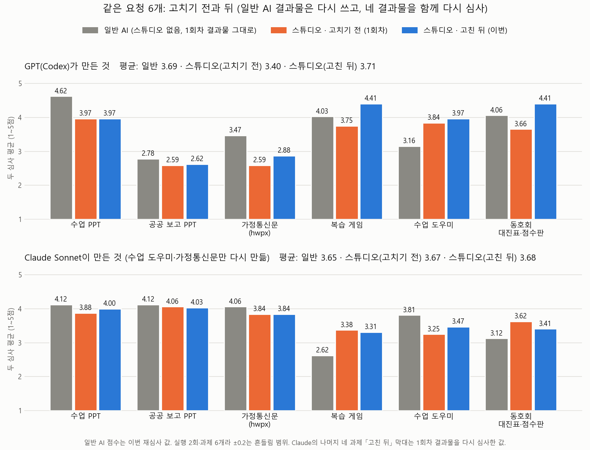

# GPT(Codex)에서 스튜디오가 손해를 보던 것을 고치고 다시 잰 결과 (2026-11-21)

앞 문서: [`cross-vendor-2026-11.md`](cross-vendor-2026-11.md) (GPT에 스튜디오를 붙이면 3.80 → 3.40으로 내려갔다).

## 결론 먼저

- **GPT(Codex) 평균은 「손해」에서 「비김」이 됐다.** 일반 3.69 대 스튜디오 3.71 (+0.02). 고치기 전에는 3.80 대 3.40 (-0.40)이었다. 맞대결은 3승 9패 → 5승 7패.
- **하지만 6개 과제 중 3개는 아직 진다.** 수업 PPT -0.66(그대로), 가정통신문 -0.59(전 -0.91), 공공 보고 PPT -0.16(전 -0.19). 「모든 과제에서 스튜디오 ≥ 일반 AI」는 아직 아니다.
- **이긴 3개:** 복습 게임 +0.38(전 -0.53), 수업 도우미 +0.81(전 +0.38), 동호회 대진표·점수판 +0.34(전 -0.56).
- **이긴 3개에서 GPT는 우리 조립 도구를 쓰지 않았다.** 「도구는 바닥」 규칙을 읽고 게임·프로그램·대진표를 손으로 만든 뒤 우리 점검기(`check_webapp.py`)만 돌렸다. 즉 이 승리는 스튜디오의 「규칙과 점검」이 낸 것이지 「조립 도구」가 낸 것이 아니다.
- **첫 재측정에서는 평균이 그대로였다(3.39).** 동호회 과제가 -1.78로 더 나빠졌기 때문이다(손으로 만든 화면이 빈 입력칸에서 시작). 규칙 두 줄을 더 고친 뒤 그 과제와 수업 PPT만 다시 만들어 위 수치가 됐다. 같은 과제 6개를 보며 두 번 고친 것이므로, 새 과제에서도 같은지는 확인하지 못했다.
- **보안 상자 문제는 사라졌다.** 「임시 폴더 쓰기 거부」 17번 → 0번, 「액세스 거부」 16번 → 0번. GPT 실행당 명령 수 22.5 → 14.0, 실패한 명령 6.4 → 3.7, 읽은 양(입력 토큰) 1670만 → 892만.
- **1회차가 놓친 버그 둘을 찾아 고쳤다.** (1) 1회차 게임 실행 하나는 조립 도구가 임시 폴더 때문에 멈춰 GPT가 손으로 만든 것이었다(「막는 버그는 없었다」는 1회차 문장은 틀렸다). (2) Windows에서 `setup.py`로 설치한 스킬 폴더를 Codex 보안 상자가 읽지 못한다. 1회차는 폴더를 복사해 넣어 시험했기 때문에 드러나지 않았다.
- **Claude는 나빠지지 않았다.** 다시 만든 두 과제: 수업 도우미 -0.62 → -0.34, 가정통신문 -0.19 → -0.22. 전체 3.65 대 3.68. 가장 낮은 실행이 2.44 → 3.12로 올랐다. 일반 AI를 못 이긴 것은 그대로다.
- **「확인 필요 · 교사 초안」 규칙은 바꾸지 않았다(소유자 결정 대기).** 가정통신문과 보고 PPT가 아직 지는 가장 큰 이유가 이것이다. 선택지별 문구 안은 아래 「빈칸 방식」.
- 실행 2회·과제 6개다. 같은 파일을 다시 심사하기만 해도 과제 점수가 0.2쯤 움직였다(Claude 동호회 +0.47 → +0.28). ±0.3 안쪽은 차이로 읽지 않는 것이 안전하다.

## GPT(Codex): 고치기 전과 뒤

점수는 1~5점, 4항목 평균, 두 심사(Opus·GPT) 평균. 「일반」은 1회차에 만든 파일 그대로이고 점수만 이번 재심사 값이다.

| | 일반 평균 | 스튜디오 평균 | 차이 | 스튜디오 최저 실행 | 맞대결(승-패-무) |
|---|---|---|---|---|---|
| 고치기 전 (1회차) | 3.80 | 3.40 | -0.40 | 2.56 | 3-9-0 |
| 고친 뒤 첫 재측정 | 3.72 | 3.39 | -0.33 | 2.00 | 4-8-0 |
| 고친 뒤 둘째 재측정 (최종) | 3.69 | 3.71 | +0.02 | 2.56 | 5-7-0 |

심사자별 최종: Opus 3.30 → 3.39 (+0.08, 7승 5패), GPT 4.07 → 4.03 (-0.04, 5승 6패 1무). 1회차는 Opus -0.33, GPT -0.47이었다.

### 과제별 (일반 → 스튜디오, 괄호는 차이)

| 과제 | 고치기 전 | 첫 재측정 | 최종 | 최종: Opus 심사 | 최종: GPT 심사 | 스튜디오 ≥ 일반? |
|---|---|---|---|---|---|---|
| 수업 PPT | 4.56 → 3.97 (-0.59) | 4.56 → 3.91 (-0.66) | 4.62 → 3.97 (-0.66) | 4.50 → 3.50 (-1.00) | 4.75 → 4.44 (-0.31) | 아니오 |
| 공공 보고 PPT | 2.78 → 2.59 (-0.19) | 2.78 → 2.62 (-0.16) | 2.78 → 2.62 (-0.16) | 2.38 → 2.50 (+0.12) | 3.19 → 2.75 (-0.44) | 아니오 |
| 가정통신문(hwpx) | 3.50 → 2.59 (-0.91) | 3.47 → 2.88 (-0.59) | 3.47 → 2.88 (-0.59) | 2.94 → 2.56 (-0.38) | 4.00 → 3.19 (-0.81) | 아니오 |
| 복습 게임 | 4.28 → 3.75 (-0.53) | 4.03 → 4.41 (+0.38) | 4.03 → 4.41 (+0.38) | 3.62 → 4.19 (+0.56) | 4.44 → 4.62 (+0.19) | 예 |
| 수업 도우미 | 3.47 → 3.84 (+0.38) | 3.16 → 3.97 (+0.81) | 3.16 → 3.97 (+0.81) | 2.62 → 3.56 (+0.94) | 3.69 → 4.38 (+0.69) | 예 |
| 동호회 대진표·점수판 | 4.22 → 3.66 (-0.56) | 4.34 → 2.56 (-1.78) | 4.06 → 4.41 (+0.34) | 3.75 → 4.00 (+0.25) | 4.38 → 4.81 (+0.44) | 예 |

- 둘째 재측정에서 다시 만든 것은 수업 PPT와 동호회 과제뿐이다. 나머지 네 과제의 「최종」은 첫 재측정 값 그대로다.
- 일반 AI 점수가 칸마다 조금 다른 것은 같은 파일을 네 결과물 묶음으로 다시 심사했기 때문이다(예: 동호회 일반 4.22 / 4.34 / 4.06).

### 항목별 (두 심사 합침)

| 조건 | 내용 | 디자인 | 가독성 | 목적 적합 |
|---|---|---|---|---|
| GPT 일반 (이번 재심사) | 3.48 | 4.25 | 3.40 | 3.62 |
| GPT 스튜디오 · 고치기 전 | 2.83 | 3.65 | 3.88 | 3.25 |
| GPT 스튜디오 · 고친 뒤 | 3.27 | 3.85 | 4.04 | 3.67 |

내용 +0.44, 디자인 +0.20, 목적 적합 +0.42. 내용과 디자인은 아직 일반 GPT보다 낮고(-0.21, -0.40), 가독성과 목적 적합은 높다.

### 시간·명령·점검기

| | 시간 중앙값 | 시간 평균 | 실행당 명령 수 | 실행당 실패한 명령 | 임시 폴더 쓰기 거부 | 그 밖의 액세스 거부 | 입력 토큰 합(12회) | 점검기 통과 |
|---|---|---|---|---|---|---|---|---|
| GPT 일반 | 322초 | 357초 | 11.8 | 4.2 | 0 | 6 | 655만 | 2/12 |
| GPT 스튜디오 · 고치기 전 | 324초 | 352초 | 22.5 | 6.4 | 17 | 16 | 1670만 | 8/12 |
| GPT 스튜디오 · 고친 뒤 | 306초 | 284초 | 14.0 | 3.7 | 0 | 0 | 892만 | 6/12 |

- 12개 실행 모두 요청한 형식의 파일이 나왔고 열렸다. 시간 초과 없음.
- 「실패한 명령」에는 우리 스크립트가 일부러 내는 종료 코드(점검 일부를 못 했을 때의 `PARTIAL` = 2)와 검색 결과 없음도 들어 있다.
- **점검기 통과는 8/12 → 6/12로 내려갔다.** 실패 6줄: 보고 PPT 1(표지 「학교명」), 가정통신문 1(`[학교명]` 등 대괄호 빈칸 9곳을 남긴 채 냄), 수업 도우미 2(P 키 프로젝터 모드 없음: 손으로 만든 화면), 동호회 2(확인 창 `confirm` 사용: 손으로 만든 화면). 손으로 만들면 우리 조립 도구가 공짜로 주던 것 일부가 빠진다.
- 스크립트 사용: PPT 4회 모두 `deck.py`, 가정통신문 2회 모두 `docs.py`. 게임·수업 도우미·동호회 6회는 `build.py` / `build_webapp.py` / `build_tool.py`를 한 번도 쓰지 않고 `check_webapp.py`와 `deliver.py`만 썼다.

## 아직 지는 곳과 이유

1. **수업 PPT (-0.66, 고친 뒤에도 그대로).** 사료 읽기(『북학의』), 활동, 정답 장은 들어갔다. 그래도 Opus 심사 노트는 네 번 모두 「홍대용·국학 연구 등이 빠져 내용이 얕다」고 했고, 「단조롭다」「빈 상자·여백이 많다」가 되풀이됐다. 「다룰 것 목록을 먼저 쓰고 모두 싣기」 규칙을 넣은 둘째 재측정에서도 3.91 → 3.97로 달라지지 않았다. 일반 GPT의 PPT가 4.6으로 이번 12칸 중 가장 높은 점수라는 점도 있다. 원인이 규칙 글인지, 장 종류와 한 장 글자 수 제한 같은 도구 쪽인지는 가려내지 못했다.
2. **가정통신문 (-0.59).** 네 번(1회차 2, 이번 2) 모두 본문에 「교사 초안」이 찍히고 회신서가 없다. 이번에는 일정표 칸이 「확인 필요」(9곳) 또는 `[수영장명]` 같은 대괄호(9곳)다. 「회신서를 넣어라」는 줄을 스킬에 넣었지만 「확인 필요」 규칙이 더 세게 읽혔다. 규칙을 바꾸지 않기로 한 부분이다.
3. **공공 보고 PPT (-0.16).** 일반·스튜디오 둘 다 2.6~2.8로 낮다. 스튜디오 쪽은 수치 칸이 「확인 필요」(한 파일에 45번)다. 같은 규칙이다.

## Claude: 나빠지지 않았는지

수업 도우미와 가정통신문만 스튜디오 조건으로 2회씩 다시 만들었다. 나머지 네 과제는 1회차 파일을 다시 심사만 했다.

| | 일반 평균 | 스튜디오 평균 | 차이 | 스튜디오 최저 실행 | 맞대결 |
|---|---|---|---|---|---|
| 고치기 전 (1회차) | 3.67 | 3.67 | +0.01 | 2.44 | 7-4-1 |
| 고친 뒤 (최종) | 3.65 | 3.68 | +0.03 | 3.12 | 6-6-0 |

| 과제 | 고치기 전 | 고친 뒤 | 실행별 스튜디오 점수 (전 → 뒤) | 시간 (전 → 뒤) | 비용 (전 → 뒤) |
|---|---|---|---|---|---|
| 수업 도우미 (다시 만듦) | 3.88 → 3.25 (-0.62) | 3.81 → 3.47 (-0.34) | 4.06, 2.44 → 3.38, 3.56 | 134·112초 → 220·187초 | $0.42·$0.37 → $0.60·$0.53 |
| 가정통신문 (다시 만듦) | 4.03 → 3.84 (-0.19) | 4.06 → 3.84 (-0.22) | 3.94, 3.75 → 3.88, 3.81 | 28·38초 → 47·51초 | $0.17·$0.19 → $0.23·$0.24 |
| 수업 PPT (다시 심사만) | 3.97 → 3.88 (-0.09) | 4.12 → 4.00 (-0.12) | | | |
| 공공 보고 PPT (다시 심사만) | 4.19 → 4.06 (-0.12) | 4.12 → 4.03 (-0.09) | | | |
| 복습 게임 (다시 심사만) | 2.66 → 3.38 (+0.72) | 2.62 → 3.31 (+0.69) | | | |
| 동호회 (다시 심사만) | 3.28 → 3.62 (+0.34) | 3.12 → 3.41 (+0.28) | | | |

- 수업 도우미: 1회차의 무너진 실행(2.44) 같은 것은 없었지만 1회차의 좋은 실행(4.06)만큼 높은 것도 없었다. 평균 차이는 실행 2회로는 흔들림 범위다. 일반 AI보다는 여전히 낮다.
- Claude는 두 과제 모두 우리 조립 도구(`build_webapp.py`, `docs.py`)를 썼고 점검기를 통과했다(4/4). 가정통신문에는 예시 일정·회신 기한·회신서를 채웠다(GPT와 다른 점).
- 내용을 더 넣으라는 규칙 때문에 시간이 50~80초, 비용이 실행당 $0.05~0.18 늘었다. Claude 스튜디오 12회 합계 $4.04 → $4.48 (일반 $7.49).
- Claude는 둘째로 고친 규칙(다룰 것 목록, 열자마자 쓸 수 있게)으로는 다시 만들지 않았다.

## 무엇을 고쳤나

### (가) 임시 폴더: 보안 상자 안에서 원인을 재현했다
- `codex sandbox`(모델 없이 보안 상자 안에서 명령만 실행)로 확인: Python 3.13의 `tempfile.mkdtemp()` · `TemporaryDirectory()`가 만든 폴더는 **어디에 만들든**(지금 폴더 안이어도) 보안 상자가 그 안에 쓰지 못한다. 보통 `mkdir`로 만든 폴더는 된다. 1회차 문서의 추정(「만든 사용자 전용 권한」)이 맞았다.
- 그래서 `TEMP`를 옮기는 것으로는 안 되고, 그 두 함수를 쓰지 않아야 한다. 새 `shared/tools/workdir.py`: 작업 폴더를 `TEACHER_STUDIO_TMP` → 결과 파일 옆 `.teacher-studio-work/` → 지금 폴더 → 시스템 임시 폴더 → `~/.teacher-studio/tmp` 순서로 실제로 써 보고 정하고, 끝나면 지운다.
- 바꾼 곳 14개: `deck.py`, `pptx_render.py`, 게임 `build.py` · `fire.py`, 수업 도구 `shots.py`, `docs.py`, `pdf_tools.py`, `deliver.py`, `direction.py`, `storyboard.py`, `doctor.py`, `render_mp4.py`, `video_eyes.py`, `ensure.py`.
- **1회차가 놓친 것:** 게임 `build.py`는 이 문제로 아예 멈췄다. 1회차 GPT 스튜디오 게임 실행 하나는 조립 도구를 포기하고 손으로 만든 것이었고, 다른 하나는 모델이 `os.mkdir`를 바꿔치기해서 겨우 돌렸다.

### (나) 설치: Codex가 실제로 읽는 곳에 들어가는가
- `setup.py --agent codex`는 `~/.agents/skills`에 넣는다. Codex CLI 0.171.0은 그곳을 읽는다(소유자의 `~/.agents/skills`에 있는 스킬 3개가 격리한 실행에서도 목록에 보였다. 1회차 기록). 소유자의 `~/.agents/skills`에 교사 스튜디오 스킬은 없다(읽기만 했다).
- **버그:** `setup.py`가 스킬을 `tempfile.mkdtemp()` 폴더에서 준비한 뒤 옮겼다. Windows에서는 그 「만든 사람만」 권한이 옮긴 뒤에도 남아서, 설치된 `SKILL.md`를 보안 상자 안에서 읽으면 「Permission denied」가 난다(1회차에 임시 홈에 설치해 둔 폴더로 재현). 보통 폴더에서 준비하도록 고쳤고, 새로 설치한 폴더는 보안 상자 안에서 읽힌다(확인).
- 이전 설치기로 Windows에 설치했다면 같은 명령으로 한 번 다시 설치해야 한다(`INSTALL.md`에 적음).
- 평가는 1회차와 같은 방식(임시 홈에 `setup.py`로 설치 → 8개 폴더를 격리한 `CODEX_HOME/skills`에 복사)으로 했다. `~/.agents/skills`에 직접 설치한 상태로 모델을 돌려 보지는 않았다.

### (다) 화면을 못 띄울 때
- 보안 상자는 브라우저가 쓰는 통로(named pipe)를 막는다. 같은 통로를 한 번 열어 보는 것으로 몇 ms 만에 알 수 있다(`workdir.browser_blocked()`).
- 막혀 있으면 스크립트가 `NO-BROWSER` 한 줄(다시 시도하지 말 것, 마지막 안내에 한 줄만 적을 것)을 한 번 말하고, 브라우저가 필요한 점검만 건너뛴다. 「Playwright가 설치되지 않음」으로 읽히던 문구도 바로잡았다.
- PPT는 Pillow로 그린 밑그림(`pptx_sketch.py`, `<이름>-sketch-sheet.png`)을 낸다. 이번 GPT 실행 12회에서 브라우저를 띄우려는 시도와 직접 미리보기 그림을 그리는 코드는 0번이었다(브라우저가 설치돼 있는지만 확인한 실행이 3회). 1회차에는 직접 그림을 그리는 코드를 짜고 크롬을 여러 방법으로 띄워 보았다.
- PDF는 브라우저 없이는 못 만든다. 바로 그렇게 말하고 「Ctrl+P → PDF로 저장」을 안내한다.
- `TEACHER_STUDIO_NO_BROWSER=1`로 어디서든 같은 길을 시험할 수 있다(`tools/test_sandbox_safe.py`).

### (라) 「도구는 바닥이지 천장이 아니다」
스킬 글에서 최소 구성·도구가 정한 모양으로 읽히던 줄:

| 파일 | 전 | 뒤 |
|---|---|---|
| `shared/content/CONTENT-RULES.md` | 「cut, not shrunk」「Do not pad」만 있음 | 「Floor, not ceiling」 절: 깊이, 화면당 제한은 내용 제한이 아님, 도구에 자리가 없으면 직접 만들어 같은 점검, 디자인 우선순위(사용자 > 근거 있는 내 디자인 > 도구 기본), 직접 만들어도 열자마자 쓸 수 있게 |
| `teacher-game/SKILL.md` | 「Never write colours, fonts or sizes」「custom code only if the user insists」 | 4지선다 한 가지는 바닥. 볼 것이 있으면 그림, 내용 모양에 맞는 방식, 안 되면 직접 만들고 `check_webapp.py` |
| `teacher-slides/SKILL.md` | 「colours picked by the tools, never by you」「flair: Keep it rare」 | 깊이 먼저(사료·과정·그림·확인 문제 2~3개·출처), 다룰 것 목록, 화면당 제한은 장을 늘려 해결 |
| `teacher-class-tools/SKILL.md` | spec 하나 = 도구 하나 | 두 도구를 한 행사에 쓰면 한 화면에, 종목 규칙 포함. 직접 만들 때는 예시 팀이 채워진 채로 시작 |
| `teacher-studio/references/webapp.md` | 「1 part when one job is enough」 | 「직접 해 보는」 요청은 활동이 있는 `custom`, 단원의 생각마다 해 볼 것, 빈 화면·같은 답 쌓임 금지 |
| `teacher-docs/SKILL.md` | 가정통신문 구성 안내가 PDF 절에만 있음 | 형식과 상관없이: 표·준비물·안전·회신서, 반쪽짜리 A4는 미완성 |

- 화면이 바뀐 예: GPT 게임이 「그림 없는 4지선다 10문제」에서 「소화 기관 그림에서 찾기 → 순서 맞히기 → 역할 퀴즈」 3단계가 됐다. 수업 PPT에 『북학의』 사료 읽기와 정답 장이 들어갔다.
- **부작용:** 첫 재측정에서 GPT가 동호회 화면을 손으로 만들면서 빈 입력칸에서 시작하게 했다(우리 도구는 1~N번이 채워진 채로 시작한다). 심사 그림에는 입력 오류만 찍혀 2.56이 됐다. 「직접 만들어도 예시 값이 채워진 채 첫 화면에 바로 보이게」 줄을 넣은 뒤 4.41.
- `SKILL.md` 크기 상한 시험(`test_fable_upgrade.py`)은 게임 11000 → 11900, 첫 관문 15000 → 16000으로 올렸다. 자세한 내용은 `references/`로 옮겼다.

## 빈칸 방식 (소유자 결정 대기: 이번에는 바꾸지 않음)

「모르는 값은 확인 필요로 두고 교사 초안으로 표시」 규칙은 손대지 않았다. 그래서 고친 뒤에도 GPT는 가정통신문과 보고 PPT를 「교사 초안」「확인 필요」로 냈다(위 「아직 지는 곳」). 결정에 필요한 것만 적는다.

### GPT가 글자 그대로 읽은 줄 (줄 번호는 이 커밋 기준)

| 파일 : 줄 | 지금 문장 (핵심만) | GPT가 한 일 |
|---|---|---|
| `shared/content/CONTENT-RULES.md` : 25 | 모든 수·날짜·이름은 (a) 사용자 자료 (b) 이번에 확인한 출처 (c) 「확인 필요」 표시 중 하나 | 학교가 정할 날짜·장소·비용을 모두 (c)로 둠 |
| `shared/content/CONTENT-RULES.md` : 29 | Never invent statistics … An honest gap beats a confident error. | 보고 PPT 표의 수치 칸을 「집계 필요」「확인 필요」로 채움 |
| `shared/content/CONTENT-RULES.md` : 30 | Illustrative numbers are labelled 「예시(가상 수치)」 on the same screen. | 예시 수치를 쓰는 길이 있는데도 쓰지 않음 (29행이 더 세게 읽힘) |
| `shared/content/CONTENT-RULES.md` : 53 | Any blocking fact still 「확인 필요」 … → the output is a 「교사 초안」. It does not pass the gate. Say so in the first line of the final message, mark it on the teacher-facing page … | 가정통신문 머리에 「교사 초안 · 배포 전 확인」을 인쇄, 마지막 안내에도 「교사 초안」 |
| `shared/content/CONTENT-RULES.md` : 63 (G2) | no blocking fact is 「확인 필요」 (otherwise status = 교사 초안, with the open items listed) | 확인 목록을 본문에 넣음 |
| `skills/teacher-docs/references/content-docs.md` : 15 | Missing fact → ask or mark 「〈확인 필요〉」 visibly; never fill with a plausible guess. A document with an open 기한 · 대상 · 자격 · 비용 · 안전 조건 is a 「교사 초안」 and is labelled so until the teacher confirms | 일정표 칸마다 「확인 필요」 또는 `[수영장명]` 같은 대괄호 자리. 회신서 없음(4회 중 4회) |
| `skills/teacher-docs/references/content-docs.md` : 41 | 수익자 부담 경비, 안전 · 보험, 외부 강사 · 업체 names → … state it as 「확인 필요」, not as fact | 수영장·이동 방법·참가비를 「확인 필요」 |
| `skills/teacher-docs/references/content-docs.md` : 72 | No open 기한 · 대상 · 자격 · 비용 · 안전 조건; if any remains, the file is labelled 「교사 초안」 with the open items listed. | 위와 같음 |
| `skills/teacher-slides/references/content-slides.md` : 39, 57 | Invented figures are never presented as real … / … still 「확인 필요」; otherwise the deck is a 「교사 초안」 | 보고 PPT를 「제출 전 검토본」으로 내고 수치 칸은 「확인 필요」 |
| `skills/teacher-studio/SKILL.md` : 82 | Unsure facts -> mark 「확인 필요」. Never invent figures, quotes or links. | 모든 과제에서 위 해석을 뒷받침 |

같은 저장소 안에 반대로 읽히는 줄도 있다. Claude는 이쪽을 따랐다.

| 파일 : 줄 | 문장 |
|---|---|
| `skills/teacher-docs/SKILL.md` : 31 | 「알아서」 = no questions: choose plausible dates (weekdays that really match), times, deadline; unknown names -> 「우리 학교」「우리 학교장」「담임 선생님」 … Say the assumptions in one line at the end. (단, 「PDF: the short path」 제목 아래에 있어 HWPX에는 안 읽힘) |
| `skills/teacher-docs/SKILL.md` : 51 | No blanks: … fill with stated assumptions or list in "fillins" |
| `skills/teacher-slides/SKILL.md` : 44 | Unknown facts … write the plausible value, never a slot: 「우리 학교」「교육연구부」, today's date |
| `skills/teacher-slides/SKILL.md` : 94 | No blanks, ever. … Fill with a plausible stated assumption |

즉 지금 규칙은 두 가지 말을 한다: 「그럴듯한 값으로 채워라」(스킬 본문)와 「그럴듯한 값으로 채우지 마라」(내용 규칙). 어느 쪽이든 하나로 정해야 한다.

### 선택지별 문구 안

세 안 모두 공통으로 바꿀 것: **「교사 초안」 표시는 결과물 본문이 아니라 마지막 안내 말과 별도 확인 목록에만 둔다.** 본문에 「교사 초안」이 찍히면 바로 나눠 줄 수 없는 종이가 된다.

**안 1: 밑줄 빈칸.** 모르는 값은 모두 손으로 쓸 밑줄로 둔다.

- `CONTENT-RULES.md` 53행을 이렇게:
  > Any blocking fact the user did not give and you could not check → leave a labelled blank to write in by hand (`일시: 2026년 ___월 ___일(___) ___:___`, `장소: ____________`, `참가비: ________원`). Never the words 「확인 필요」 and never a 「교사 초안」 mark inside the file: the page keeps its complete layout (table, reply slip, contact line) and is ready to print once the blanks are filled. Say 「빈칸 N곳을 채우면 바로 쓸 수 있어요」 in the first line of the final message and list each blank: what, where.
- `content-docs.md` 15행 끝을 이렇게:
  > Missing fact → a labelled underline blank in its place; never a plausible guess, never the words 「확인 필요」 on the page. The document keeps every part it needs (일정 표, 준비물, 회신서) with blanks inside them.
- 함께 고칠 것: 점검기(`placeholders.py`)가 밑줄 빈칸을 통과시키도록 `"template_blanks": true`를 기본으로 하거나, 밑줄만 따로 허용. 슬라이드 `No blanks, ever`(94행)와 정면으로 부딪히므로 PPT는 예외로 둘지 정해야 한다.
- 예상: 「바로 쓸 수 없다」는 심사 감점은 줄지만 「채우지 않은 빈칸」 감점(심사 기준 content 항목)은 남는다. 정직하고 안전하다.

**안 2: 「우리 학교」 같은 자리 표시.** 모르는 값은 뜻이 통하는 일반 이름이나 그럴듯한 예시 값으로 모두 채운다.

- `CONTENT-RULES.md` 53행을 이렇게:
  > Any blocking fact the user did not give → write a plausible, clearly generic value in its place so the file reads as finished: 「우리 학교」「우리 학교장」「담임 선생님」, a real upcoming date whose weekday you computed, a round amount. Never 「확인 필요」, 「교사 초안」 or an empty slot inside the file. The first line of the final message says 「예시 값 N곳을 실제 값으로 바꿔 주세요」 and lists every one: the value you wrote, where it is, what to replace it with. Without that list the output does not pass the gate.
- `content-docs.md` 15행 끝을 이렇게:
  > Missing fact → fill it with a plausible example value and put it in `"fillins"`; the final message lists each as 「바꿔 넣을 곳」. Never leave a slot, never print 「확인 필요」 on the page.
- `CONTENT-RULES.md` 29행에 한 줄 추가: `Example values for facts only the user knows (their dates, places, counts, amounts) are not "invented statistics" when every one is listed for replacement.`
- 예상: 심사 점수는 가장 오른다(Claude가 한 방식). 위험: 예시 날짜·금액이 그대로 나가는 사고. 목록이 유일한 안전장치다.

**안 3: 섞기. 인쇄물 양식만 빈칸, 나머지는 예시 값을 채우고 한 번만 표시.**

- `CONTENT-RULES.md` 53행을 이렇게:
  > Any blocking fact the user did not give: (1) in a part the reader fills in by hand (회신서, 신청서, 동의서, 서명란) → an underline blank; (2) everywhere else (본문, 일정 표, 보고 수치, 슬라이드) → a plausible example value, so the file reads as finished. Mark the examples ONCE, in one small line where the reader of the draft will see it and can delete it (문서: 맨 아래 한 줄 `※ 날짜·장소·금액은 예시입니다. 확정 값으로 바꿔 주세요.`; PPT: 표지 발표자 메모와 표 아래 `예시(가상 수치)` 한 줄). Never 「확인 필요」 per cell, never a 「교사 초안」 stamp in the file. The final message lists every example value and every blank: what, where.
- `content-docs.md` 15행 끝을 이렇게:
  > Missing fact → an example value in the body and the tables (listed in `"fillins"`), an underline blank only inside the reply slip or form the family writes on. One line at the foot says the dates, places and amounts are examples.
- `content-slides.md` 39행은 그대로 두되 「한 장에 한 번」을 「자료 전체에서 처음 나오는 표 아래 한 번 + 마지막 안내의 목록」으로.
- 예상: 완성된 모양(회신서 포함)을 지키면서 예시 값이 그대로 나갈 위험을 한 줄 표시로 줄인다. 심사 기준의 「바로 쓸 수 있는가」와 「빈칸 없음」을 모두 대체로 만족한다. 규칙이 가장 길어져, 글자 그대로 읽는 모델이 (1)과 (2)를 잘못 나눌 수 있다.

어느 안이든 `teacher-docs/SKILL.md` 31행의 「알아서」 줄을 「PDF: the short path」 밖(모든 형식 공통)으로 옮겨야 HWPX에도 적용된다.

## 재측정 방법 (재현용)

- 1회차와 같은 스크립트(`cross-vendor-2026-11/xv_eval.py`)를 그대로 불러 쓴다: `cross-vendor-fix-2026-11/xvfix_eval.py` (`setup` → `run-codex` → `run-claude` → `render` → `judge opus|gpt` → `table`, 둘째 재측정은 `second-pass class-ppt general`).
- 같은 과제 6개·같은 문장·조건마다 2회·빈 폴더·25분 상한. 같은 실행 옵션: 권한·보안 상자 우회 없음, 설치 명령 거부, Codex `-s workspace-write`(인터넷 차단, 추론 강도 medium, `[windows] sandbox = "unelevated"`), 격리한 `CODEX_HOME`, 한 번에 2개까지, 브라우저는 한 번에 하나. Codex 작업 폴더는 `C:\Users\User\Downloads\xv-eval-work\fix\`.
- 다시 쓴 것: 일반 조건 24개 실행(Claude·GPT)과 Claude 스튜디오 8개 실행의 파일·그림·점검 결과. 새로 만든 것: GPT 스튜디오 12개(+ 첫 재측정에서 밀려난 4개), Claude 스튜디오 4개.
- 심사: 과제·실행마다 네 결과물을 A~D로 가려 2회(순서 바꿈). 네 개를 함께 채점하므로 6개 과제 전부 다시 심사했다. Opus 32회 $9.07, GPT 32회(구독). 64회 모두 정상 응답.
- 스킬은 `py scripts/setup.py --agent codex`와 `--agent claude-code`를 임시 홈으로 돌려 설치한 8개 폴더. 소유자의 `~/.claude`, `~/.codex`, `~/.agents`에는 쓰지 않았다.
- 원자료: `cross-vendor-fix-2026-11/table.json`(최종), `table-pass1.json`(첫 재측정), `codex-failures.json`, `raw/`(새 실행의 상태·결과 파일·점검 결과, 심사 점수와 배정표; `raw/pass1/`은 첫 재측정에서 밀려난 4개 실행과 그 심사).

## 점검한 것

- `tools/`와 `shared/tools/`의 시험 파일 27개 모두 통과(새 `tools/test_sandbox_safe.py` 16개 포함).
- `py tools/sync_shared.py` 뒤 `--check`: 복사본 717개와 `dist/` zip 일치.
- 옛 완제품 스킨 17개를 `studio.py fire`로 다시 만들어 `check` 모두 PASS.
- `setup.py --agent claude-code`와 `--agent codex`를 임시 홈에서 실행: 둘 다 성공.
- 보안 상자 안(`codex sandbox`)에서 PPT·게임·수업 도구·웹 앱·한글 문서·배포 꾸러미·환경 확인 명령이 오류 없이 끝나고 작업 폴더가 남지 않음.

## 한계와 확인하지 못한 것

- **같은 과제로 고치고 같은 과제로 쟀다.** 규칙을 두 번 고친 뒤의 수치이므로 좋게 나오는 쪽으로 기울어 있다. 새 과제로는 재지 않았다.
- 실행 2회·과제 6개·심사 2회씩. 과제 하나의 ±0.3은 실행 하나나 재심사로 뒤집힌다.
- 「고치기 전」 수치는 1회차 심사, 「고친 뒤」는 이번 심사다. 네 결과물을 함께 채점하므로 옆 결과물이 달라지면 같은 파일 점수도 움직인다.
- 「도구는 바닥」 규칙이 조립 도구를 건너뛰게 만든 것이 긴 눈으로 좋은지는 모른다. 점검기 통과가 8/12 → 6/12로 줄었고, 손으로 만든 화면은 프로젝터 모드 같은 공통 기능이 빠진다. 게임 엔진에 「그림」과 「여러 단계」를 넣는 쪽은 하지 않았다.
- 수업 PPT가 왜 그대로인지 가려내지 못했다.
- Claude는 두 과제만 다시 만들었고, 둘째로 고친 규칙으로는 다시 만들지 않았다.
- `~/.agents/skills`에 실제로 설치한 상태로 Codex 모델을 돌려 보지 않았다(권한이 읽히는지만 보안 상자에서 확인). Codex 보안 상자의 `elevated` 방식, macOS·Linux의 보안 상자는 확인하지 못했다. 브라우저 확인은 Windows에서만 미리 알아채고, 다른 곳에서는 실행해 보고 실패하면 같은 길로 간다.
- PDF는 보안 상자 안에서 여전히 만들 수 없다(안내만 한다).
- PPT 밑그림은 그림·차트를 회색 상자로만 그린다. PPT와 hwpx 심사 그림은 1회차와 같은 근사 그림이다.
- GPT 추론 강도는 medium 하나만 봤다.
