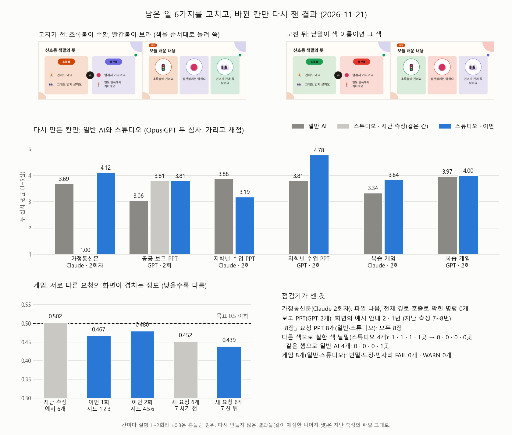

# 남은 일 6가지를 고치고, 바뀐 칸만 다시 잰 결과 (2026-11-21)

앞 문서: [`blanks-policy-2026-11.md`](blanks-policy-2026-11.md), [`cross-vendor-fix-2026-11.md`](cross-vendor-fix-2026-11.md), [`ppt-young-2026-11.md`](ppt-young-2026-11.md), [`template-removal-2026-11.md`](template-removal-2026-11.md). 네 문서 끝에 「고치지 않았다」「확인하지 못했다」로 남겨 둔 것 가운데 여섯 가지를 고쳤다. 연수 자료(`docs/training/`)는 손대지 않았다.

## 쉬운 말로 먼저

- **색 이름인 낱말은 그 색으로 칠한다.** 전에는 「초록불」 칸이 주황, 「빨간불」 칸이 보라로 나왔다(색을 순서대로 돌려 썼기 때문). 이제 「초록불」은 초록, 「빨간불」은 빨강, 「청팀·백팀」「금·은·동」도 제 색이다. 스튜디오로 만든 저학년 PPT 4개에서 다른 색으로 칠한 색 낱말이 첫 회 1곳씩이었고, 고친 뒤 다시 만든 4개는 0곳이다.
- **「8장」이라고 하면 8장이 나온다.** 이번에 만든 PPT 12개(스튜디오 8개, 일반 AI 4개)가 모두 8장이다. 지난 측정에서는 「8장 정도」에 9장이 나왔다.
- **예시 안내를 장마다 되풀이하지 않는다.** GPT의 보고 PPT는 화면의 예시 안내가 7~8번에서 2번·1번으로 줄었다. 한 번이 목표인데 한 파일은 아직 2번이다.
- **게임·웹 화면에도 빈칸 점검이 붙었다.** 「확인 필요」 같은 빈말, 「교사 초안」 도장, `[학교명]` 같은 빈자리를 본다. 이번에 만든 게임 8개는 걸린 것이 없었다(잡을 것이 없었으므로, 점검이 실제로 잡는지는 시험 파일로만 확인했다).
- **게임 화면이 서로 덜 닮는다.** 서로 다른 요청의 겹침이 0.502 → 0.467(1회) · 0.480(2회)이다. 목표는 0.5 이하다. 배치의 자리와 글자 크기는 바꾸지 않았다.
- **Claude가 파일을 못 냈던 실행은 다시 돌리니 파일이 나왔다.** 가정통신문 2회차: 1.00점(파일 없음) → 4.12점(일반 AI 3.69). Python을 전체 경로로 부른 명령은 0개였다.
- **아직 지는 칸: Claude의 저학년 수업 PPT.** 일반 3.88 대 스튜디오 3.19 (-0.69). 심사 노트는 「표지판을 단순 도형으로만 그렸다」「내용이 얕다」「설명 글씨가 작다」였다. 색 문제가 아니라 내용과 그림 문제이고, 이번에 고치지 않았다.
- 칸마다 실행 1~2회다. ±0.3 안쪽은 차이로 읽지 않는다.

## 1. 무엇을 고쳤나

### (1) 뜻이 있는 색

새 파일 `shared/design/meaning.py` 하나가 「이 낱말은 무슨 색인가」를 정한다. 색을 순서대로 나눠 주던 곳이 먼저 여기에 묻는다.

| 낱말 | 색 |
|---|---|
| 초록불 · 파란불(신호등) · 초록 · 녹색 · 🟢 | 초록 |
| 빨간불 · 빨강 · 붉은 · 홍팀 · 🔴 | 빨강 |
| 노란불 · 주황불 | 호박색 |
| 노랑 · 파랑(청팀) · 보라색 · 분홍 · 갈색 · 하늘색 · 남색 · 검정 · 하양(백팀) · 회색 | 그 색 |
| 금 · 은 · 동 (낱말 전체가 그것일 때), 금메달 · 은상 · 🥉 | 금 · 은 · 동색 |
| 「안전 / 위험」처럼 한 화면에 짝으로 나올 때만 | 초록 / 빨강 |

- 짧은 이름표만 읽는다(26자까지, 길면 첫 구절). 한 이름표에 색이 둘이면 정하지 않는다. 「금요일」「지금」「운동장」「은행나무」는 색이 아니다.
- 색 이름이 없는 옆 칸은 원래 차례의 색을 쓰되, 이름 있는 색과 비슷한 색(색상 40도 이내)은 건너뛴다.
- 적용한 곳:

| 결과물 | 적용한 곳 |
|---|---|
| PPT (`deck_pptx.py` · `deck_panel.py`) | 비교 장의 두 칸 머리와 표 머리, 목록·그림 타일·단계·연표·큰 숫자·확인 문제 보기의 배지와 띠, 카드 묶음, 그림 장의 설명 줄, `**강조**`한 낱말의 글자색 |
| 웹 슬라이드 (`deck_layouts.py`) | 비교 장 세 가지 배치(칸 머리를 그 색 알약으로, 좌우 바탕을 그 색의 옅은 색으로) |
| 게임 (`sort.js`, `build.py`) | 분류 통 색 |
| 수업 도구 (`tools.js`, `build_tool.py`) | 점수판·모둠 카드 위 띠, 시상식의 모둠 색 |
| PPT 점검기 (`pptx_check.py`) | 색 이름인 짧은 낱말이 뚜렷이 다른 색(색상 35도 넘게)으로 칠해졌으면 WARN. 손으로 만든 PPT도 본다 |

- 사용자의 템플릿(`--template`)으로 만들 때는 적용하지 않는다(사용자 디자인이 먼저).
- 화면에서 도는 것(게임 통, 점수판의 팀 이름)은 같은 표를 작은 스크립트로 넣어 쓴다(`meaning.js()`). Python과 같은 답을 내는지 시험이 지킨다.

### (2) 장수

- `"target_slides": N`은 이제 「N장」이다. 자동으로 붙는 「확인 문제 정답」 장을 넣어 센다.
- N장이면 통과. 정답 장 때문에 N+1장이면 통과. 그 밖에 넘거나 모자라면 `WARN 장수: 요청은 8장인데 9장이에요 …`. 많이 넘으면(약 7분의 1 넘게) 전처럼 조립이 멈춘다.
- 스킬 글: 「확인 문제가 있으면 10장 요청에 9장을 쓴다(정답 장이 10장째)」.
- `deck_shape.py`에 `length()` · `length_notes()`를 두었고, `deck_shape.py deck.json`으로도 같은 WARN을 본다(학습 목표·정리처럼 자동으로 들어가는 장도 센다).

### (3) 예시 안내 한 번

- 원인: 공공 보고 자료는 자료 장마다 출처가 꼭 있어야 한다. 수치가 예시이니 GPT가 출처 줄마다 「자료: 가상 …」「… 기준 예시」라고 적었다.
- 조립기: 출처·주석 줄 두 곳 이상에 「가상」「예시」가 있으면 멈추고 이렇게 말한다. 「출처 줄에는 자료 이름만 쓰고, 예시로 채운 값은 `fillins`에 적으세요(첫 장 발표자 메모에 안내 한 줄이 자동으로 들어가요)」.
- 스킬 글(`SKILL.md`, `content-slides.md`)에 같은 문장을 넣었다.
- 우리가 넣어 둔 보고 예시 2개(`public-ai-edu-report.json`, `public-device-check.json`)가 스스로 이 규칙을 어기고 있어서 고쳤다.
- 예시 안내를 세는 점검이 「수치는 예시」「예시로 작성함」, 「예시」 한 낱말짜리 표시도 센다(전에는 「…예시입니다」 꼴만 셌다).

### (4) HTML 결과물의 빈칸 점검

`shared/tools/placeholders.py`의 `html_checks()`. 게임(`check_game.py`), 웹 앱(`check_webapp.py`), 수업 도구(`check_tool.py`), 웹 슬라이드·영상 화면(`check_page.py`)이 부른다. 화면의 글과, 그 화면이 쓰는 문제 목록 같은 자료 글을 함께 읽는다.

| 점검 | 문서·PPT | HTML |
|---|---|---|
| 「확인 필요」「집계 필요」「추후 확정」 같은 빈말 | 1~2곳 WARN, 3곳 이상 FAIL | 같음 |
| 「교사 초안」「배포 전 확인본」 도장 | FAIL | 같음 |
| `[학교명]` · `{{이름}}` · `○○초` · `20XX` · `(예시)` · `(날짜 입력)` 빈자리 | FAIL | FAIL |
| 예시 안내 두 번 이상 | WARN | WARN |
| 예시 안내 없음 | WARN (보고·홍보 자료) | 보지 않음(수업용 게임·도구는 안내 없이 채운다) |
| 본문의 밑줄 빈칸 | WARN | 보지 않음 |

화면이 「일하는 중」이라서 빈자리가 아닌 것은 세지 않는다: 빈칸 채우기 문제의 `○○` · `□□` · `___`, 대진표의 「미정」, 입력칸의 「여기에 답을 입력하세요」「입력 필요」, `[힌트]` · `[1단계]` 같은 이름표, 0점인 점수 `000`, 「제출 전 확인하기」 같은 할 일 줄. 넣어 온 부품(vendor) 코드, 주석, 그림 자료는 읽지 않는다.

### (5) 게임 배치

- 예시 게임 6개가 쓸 수 있는 배치를 하나씩 모두 만들어 지문을 얻고, 「다른 요청의 배치들과 평균 얼마나 겹치는가」를 쟀다.

| 배치 | 다른 요청과의 평균 겹침 | 전 가중치 | 새 가중치 |
|---|---|---|---|
| `left` · `right` | 0.42~0.56 | 1.25 | 1.4 |
| `stair` | 0.45~0.47 | 1.0 | 1.4 |
| `stack` | 0.42~0.49 | 0.25 | 1.3 |
| `rail` | 0.47 | 1.2 | 1.3 |
| `news` | 0.49~0.51 | 1.4 | 1.2 |
| `column` | 0.44~0.58 | 0.8 | 0.6 |
| `poster` | 0.46~0.57 | 0.8 | 0.4 |
| `bento` | 0.52~0.63 | 0.5 | 0.2 |
| `split` | 0.54~0.65 | 0.25 | 0.1 |

- 전에는 「화면을 넓게 쓰는 `stack`이 많이 겹칠 것」이라고 보고 눌러 두었다. 재어 보니 `stack`은 내용에 따라 높이가 달라져 겹침이 가장 낮은 쪽이었고, 반씩 꽉 채우는 `split`이 가장 높았다.
- 넓은 배치 셋(`stack` · `split` · `bento`)만 가능한 내용(보기가 긴 방탈출)은 `stack`을 더 고른다. 보기가 길어 가는 막대로 바뀌는 내용은 `stack`을 조금 더, `column`을 조금 덜 고른다.
- 가중치만 바꿨다. 배치의 자리·크기·글자 크기, 「이 내용에 이 배치는 못 쓴다」는 규칙은 그대로다. 내용이 허락하는 배치는 덜 뽑힐 뿐 빠지지 않는다(가중치 최소 1).

### (6) Python 부르는 법

- 스킬 8개의 `SKILL.md`가 같은 말을 한다: 「`python3`로 적힌 명령은 Windows에서 `py`(없으면 `python`)로. 짧은 이름으로만 부르고 전체 경로(`C:\...\python.exe`)는 쓰지 않는다.」
- 첫 관문 스킬은 「`doctor`가 적어 둔 `python_path` 경로로 부를 수 있다」고 했었다. 그 말을 뺐다. 이름으로 안 될 때는 `scripts/run.cmd`가 찾아 준다(`run.cmd` 파일은 바꾸지 않았다).
- 측정용 허용 목록(`blanks-policy-2026-11/bp_eval.py`의 `interpreter_rules()`): 전에는 `py` · `python` · `python3` · `node`로 시작하는 명령만 받았다. 이제 그 네 프로그램이 이 PC에서 가리키는 전체 경로도 받는다(역슬래시·슬래시·`/c/` 꼴, 따옴표 있든 없든). 설치 명령 거부 목록은 그대로다.
- 한 줄 명령으로 확인: Bash 도구의 `"C:/…/python.exe" -c …`는 이제 실행된다. PowerShell 도구의 `& "C:\…\python.exe" …` 꼴은 허용 규칙을 어떻게 적어도 권한 층이 「여러 동작이 들어 있다」며 막는다(경로, 따옴표 경로, `*python.exe*`, `python.exe:*` 네 가지를 해 봤다). 이 꼴은 그대로 막힌다.

## 2. 다시 잰 것

바뀐 칸만 다시 만들었다. 심사는 늘 네 결과물(일반 Claude · 스튜디오 Claude · 일반 GPT · 스튜디오 GPT)을 A~D로 가려 함께 채점하므로, 다시 만들지 않은 셋은 지난 측정의 파일을 그대로 두고 함께 다시 채점했다.

### 점수 (1~5점, 4항목 평균, Opus·GPT 두 심사 평균)

| 칸 | 일반 AI | 스튜디오 | 차이 | 스튜디오 실행별 | 지난 측정의 같은 칸(스튜디오) |
|---|---|---|---|---|---|
| 가정통신문 · Claude · 2회차 (다시 만듦) | 3.69 | 4.12 | +0.43 | 4.12 | 1.00 (파일 없음) |
| 공공 보고 PPT · GPT · 2회 (다시 만듦) | 3.06 | 3.81 | +0.75 | 3.81, 3.81 | 3.81 |
| 저학년 수업 PPT · Claude · 2회 (새 주제) | 3.88 | 3.19 | -0.69 | 3.12, 3.25 | |
| 저학년 수업 PPT · GPT · 2회 (새 주제) | 3.81 | 4.78 | +0.97 | 4.75, 4.81 | |
| 복습 게임 · Claude · 2회 (새 주제) | 3.34 | 3.84 | +0.50 | 3.94, 3.75 | |
| 복습 게임 · GPT · 2회 (새 주제) | 3.97 | 4.00 | +0.03 | 3.88, 4.12 | |

같이 다시 채점한 칸(파일은 지난 측정 그대로, 일반 → 스튜디오): 가정통신문 GPT 2회차 3.12 → 3.75(지난 채점 3.31 → 3.81), 공공 보고 PPT Claude 4.13 → 3.78(-0.35, 지난 채점 4.06 → 3.81).

심사자별 (일반 → 스튜디오):

| 칸 | Opus 심사 | GPT 심사 |
|---|---|---|
| 가정통신문 · Claude · 2회차 | 4.00 → 4.12 | 3.38 → 4.12 |
| 공공 보고 PPT · GPT | 2.62 → 3.44 | 3.50 → 4.19 |
| 저학년 수업 PPT · Claude | 4.06 → 3.31 | 3.69 → 3.06 |
| 저학년 수업 PPT · GPT | 3.69 → 4.75 | 3.94 → 4.81 |
| 복습 게임 · Claude | 3.13 → 3.88 | 3.56 → 3.81 |
| 복습 게임 · GPT | 3.50 → 3.81 | 4.44 → 4.19 |

### 점검기가 센 것

| 무엇 | 결과 |
|---|---|
| Claude 가정통신문 2회차 | 파일 나옴(53초, $0.22). Python을 전체 경로로 불러 막힌 명령 0개. `py`로 불렀다. 점검 통과(빈칸·빈말·도장 없음, 회신서 있음) |
| GPT 공공 보고 PPT 2개: 화면의 예시 안내 | 2번 · 1번 (지난 측정 7~8번). 「확인 필요」 0곳 |
| 「8장」 요청 PPT | 일반 4개, 스튜디오 첫 회 4개, 스튜디오 다시 만든 4개: 12개 모두 8장 |
| 다른 색으로 칠한 색 낱말 (스튜디오 4개) | 첫 회 1 · 1 · 1 · 1곳 → 고친 뒤 다시 만든 것 0 · 0 · 0 · 0곳 |
| 같은 셈으로 일반 AI 4개 | 0 · 0 · 0 · 1곳 |
| 게임 8개(일반 4, 스튜디오 4): 빈말 · 도장 · 빈자리 | FAIL 0개, WARN 0개 |

- GPT 보고 PPT 1회차의 2번은 표지의 「운영 내용과 수치는 예시」 한 줄과 3장의 「예시」 딱지다. 2회차는 표지 한 줄뿐이다. 출처 줄에 되풀이한 것은 두 실행 모두 없다.
- 「다른 색으로 칠한 색 낱말」은 색 이름인 12자 이하 낱말의 글자색·바탕색이 그 색과 색상 35도 넘게 다른 곳이다. 검은 글씨는 세지 않는다.

### 저학년 수업 PPT를 두 번 만든 까닭

첫 회(스튜디오 4개)를 열어 보니 빈틈이 둘 있었다.

1. Claude의 두 실행: 카드 머리의 「빨간불」「노란불」「초록불」이 모두 강조색(주황) 한 가지였다. 강조한 낱말의 글자색을 색 이름으로 바꾸는 길이 없었다.
2. GPT의 두 실행: 조립 도구를 쓰지 않고 직접 PPT를 만들었고, 「초록불」을 다른 색으로 쓴 곳이 있었다. 점검기가 색을 보지 않았다.

둘을 고치고(강조한 낱말의 색, PPT 점검기의 색 낱말 WARN) 스킬을 다시 설치한 뒤 스튜디오 4개만 다시 만들었다. 위 점수는 다시 만든 것의 점수다. 첫 회 파일은 `leftovers-2026-11/raw/pass1/`에 있고, 심사하지 않았다.

다시 만든 것에서도 하나를 더 찾았다. Claude 1회차의 그림 장에서 설명 줄 「빨간불 / 노란불 / 초록불」 옆 띠가 주황·초록·보라였다(심사 노트에도 적혔다). 2회차는 「안전 / 위험」 비교에서 위험 쪽이 초록이었다. 둘 다 고쳤지만(그림 장의 설명 줄, 「안전 / 위험」 짝) 그 뒤로는 다시 만들지 않았고 시험 파일로만 확인했다.

### 게임 닮음 (`tools/game_sameness.py`, 낮을수록 서로 다름)

| 재는 것 | 서로 다른 요청 (목표 0.5 이하) | 같은 요청 (목표 0.8 이하) |
|---|---|---|
| 지난 측정, 예시 6개 | 0.502 | 0.554 |
| 이번 1회: 예시 6개, 시드 1 · 2 · 3 | **0.467** | 0.451 |
| 이번 2회: 예시 6개, 시드 4 · 5 · 6 | **0.480** | 0.538 |
| 새 요청 6개(이번에 처음 쓴 것), 고치기 전 | 0.452 | 0.540 |
| 새 요청 6개, 고친 뒤 | 0.439 | 0.569 |

- 시드별: 1회 0.387 · 0.450 · 0.563, 2회 0.512 · 0.484 · 0.445. 시드 하나만 보면 0.5를 넘는 것이 있고(6개 중 2개), 세 시드 평균이 목표선 아래다.
- 재어 둔 지문으로 시드 30개를 계산해 보면 평균 0.465이고, 세 시드씩 묶은 10묶음 가운데 9묶음이 0.5 이하, 1묶음이 0.506이다. 「언제나 0.5 아래」는 아니다.
- 읽기: 가중치만 바꿨으므로 배치 하나하나는 전과 같다. 예시 6개와 새 요청 6개를 시드 1~3으로 만든 36판에 전체 점검기를 돌렸다. 글자 잘림·넘침 FAIL은 0개다. 다른 작업이 함께 돌던 첫 회에 「시간 안에 진행이 끝나지 않음」「한 장면 계산 시간」 FAIL이 8판 나왔고, 조용할 때 다시 돌리니 8판 모두 통과했다(한 판은 세 번째에 통과).

## 3. 아직 지는 곳과 남은 것

1. **Claude 저학년 수업 PPT (-0.69).** 심사 노트 8개에서 되풀이된 말: 「표지판을 단순 도형(오각형·삼각형·원)으로만 그려 실제 표지판과 다르다」(두 실행 모두, 두 심사 모두), 「내용이 얕다」「같은 설명이 두 번 나온다」, 「설명 칸과 신호등 옆 글씨가 작다」, 「자동차 신호와 보행자 신호의 구분이 흐리다」. 색에 관한 말은 둘이다: 「설명 상자의 강조색이 노란불·초록불과 맞지 않는다」「위험 행동에 초록색을 썼다」(둘 다 위에서 고친 것). 일반 Claude도 정지 표지를 네모로 그려 지적받았지만 글자가 크고 색 대비가 뚜렷하다는 평을 받았다. 스튜디오 GPT는 같은 스킬로 4.78이다(표지판을 그림으로 그리고 자동차·보행자 신호를 나눠 설명했다). 원인이 그림 도구(도형 몇 개로 그리는 `diagram`)인지 내용 깊이인지 가려내지 않았다.
2. **GPT 보고 PPT의 예시 안내가 한 파일에서 아직 2번이다.** 점검기는 WARN을 낸다.
3. **Claude 공공 보고 PPT (-0.35).** 이번에 손대지 않은 칸이고 파일도 지난 측정 그대로다. 다시 채점한 값이다.
4. **GPT 복습 게임은 비김(+0.03)이다.** 지난 측정(다른 주제)에서는 +0.38이었다. GPT 심사는 일반 쪽을 더 높게 줬다(4.44 대 4.19).

## 4. 재측정 방법 (재현용)

- `leftovers-2026-11/lo_eval.py`: `setup` → `run rerun` → `run color` → (`pass1` → `setup` → `run color2`) → `run game` → `render` → `judge opus|gpt` → `table` → `collect`. 앞 두 측정의 코드(`xv_eval.py` ← `bp_eval.py`)를 그대로 불러 쓴다. 개수는 `lo_checks.py`, 그림은 `lo_plot.py`.
- 과제 문장(끝에 「알아서 끝까지 만들어 줘. 결과 파일은 지금 폴더에 저장해 줘.」):
  - 가정통신문, 공공 보고 PPT: 지난 측정과 같은 문장.
  - 저학년 수업 PPT: 「초등학교 2학년 안전한 생활 '신호등 색깔과 교통안전 표지판' 수업용 PPT 만들어 줘 (8장, 파워포인트 파일로)」
  - 복습 게임: 「초등학교 4학년 사회 '우리 지역의 공공 기관' 복습 게임 만들어 줘」
  - 새 주제 둘은 저장소에 쓰인 적이 없는지 `git grep`으로 확인하고 실행 전에 정했다.
- 만든 AI: Claude Sonnet, GPT(Codex CLI, `gpt-6.2-sol`). 새로 만든 실행 23개(첫 회로 밀려난 4개 포함). 25분 상한, 시간 초과 없음, 모두 파일이 나왔다.
- 실행 옵션은 앞 측정과 같다. 권한·보안 상자 우회 없음, 설치 없음. Claude: `claude -p --permission-mode acceptEdits` + 허용 목록(이번부터 Python·node의 전체 경로 포함) + 설치 명령 거부 목록. Codex: `codex exec -s workspace-write`(인터넷 차단), 격리한 `CODEX_HOME`, `[windows] sandbox = "unelevated"`. 한 번에 2개까지, 브라우저는 한 번에 하나. 게임 칸부터는 `claude -p`를 한 번에 하나만 돌렸다(같은 PC에서 다른 작업이 같은 로그인을 쓰고 있었다).
- Codex 작업 폴더는 `C:\Users\User\Downloads\xv-eval-work\leftovers\`에 두고 측정 뒤 `xv-eval-work` 폴더째 지웠다. 소유자의 `~/.claude`, `~/.codex`, `~/.agents`에는 쓰지 않았다(로그인 정보는 읽어서 격리한 설정 폴더에 복사만 했다).
- 심사: 과제·실행 7묶음 × 2회(순서 바꿈) × 심사 둘 = 28회, 모두 정상 응답. Opus $4.36, GPT는 구독. Claude로 만든 실행 비용 합 $4.96.
- 원자료: `leftovers-2026-11/table.json`(점수와 심사 노트), `checks.json`(점검기가 센 것), `sameness-*.json`, `raw/`(새 실행의 상태·결과 파일·점검 결과, 심사 28회의 점수와 배정표, `raw/pass1/`은 첫 회 스튜디오 PPT 4개).

## 5. 점검한 것

- 시험: `tools/`와 `shared/tools/`의 시험 파일 29개, 시험 473개 모두 통과(원래 건너뛰는 선택 시험 1개). 새 `tools/test_leftovers.py`가 28개다.
- `py tools/sync_shared.py` 뒤 `--check`: 복사본 728개와 `dist/` zip 일치.
- 옛 완제품 스킨 17개를 `studio.py fire`로 다시 만들어 `check` 모두 READY, FAIL 0 · WARN 0. 새 HTML 빈칸 점검이 17개 어디에서도 잘못 울리지 않았다.
- `setup.py --agent claude-code`와 `--agent codex`를 임시 홈에서 실행: 둘 다 성공(측정 준비 때 두 번, 마지막 코드로 한 번 더).
- 이전 시험 가운데 바꾼 것: `test_slides_context.py`(보고 예시의 출처 줄이 바뀜), `test_fable_upgrade.py`(게임 `SKILL.md` 상한 11900 → 12300, 첫 관문 16300 → 16500. 첫 관문 쪽은 같은 시간에 다른 작업이 그 파일에 글을 더한 몫이 크다).

## 6. 한계와 확인하지 못한 것

- **색**: 웹 슬라이드는 비교 장만 적용했다. 웹 슬라이드의 목록·단계·강조한 낱말·그림 장 설명 줄, 일반 표의 첫 칸(「노란색 주의」 같은 줄), 게임의 보기 버튼(원래 색을 돌려 쓰지 않는다), 손으로 만든 HTML 화면은 적용하지도 점검하지도 않는다. 색 낱말 표는 한국어 낱말과 색 동그라미 이모지만 안다.
- **색**: 「안전 / 위험」 짝과 그림 장 설명 줄은 마지막 측정 뒤에 고쳤다. 모델로 다시 만들어 보지 않았다.
- **색**: 심사 그림에서 색이 맞는지 따로 묻지 않았다. 점수 차이가 색 때문인지는 알 수 없다. 일반 AI도 색 낱말을 틀리게 칠한 곳이 거의 없었다(4개 중 1곳).
- **장수**: 일반 AI도 4개 모두 8장이었다. 「8장」처럼 딱 잘라 말한 요청 하나만 봤다. 「10장 정도」나 「20장」은 다시 재지 않았다.
- **예시 안내**: 다시 만든 것은 GPT 보고 PPT 2개뿐이다. 점수는 3.81로 지난 측정과 같다(좋아지지도 나빠지지도 않았다).
- **HTML 빈칸 점검**: 이번 게임 8개에는 잡을 것이 없었다. 「잘못 울리지 않는다」(스킨 17개, 게임 8개)와 「시험 파일의 빈말·도장·빈자리를 잡는다」만 확인했다. 웹 앱·수업 도구는 모델로 만들어 보지 않았다. 「미정」「입력 필요」를 세지 않기로 한 것 때문에 놓치는 경우가 있을 수 있다.
- **게임 닮음**: 가중치는 같은 예시 6개를 재어서 정했고 같은 6개로 다시 쟀다. 새 요청 6개에서는 0.452 → 0.439로 조금만 내려갔다(원래 0.5 아래였다). 시드 묶음 10개 중 1개는 계산으로 0.506이다. `stack`이 더 자주 나온다(시드 30개 계산에서 예시별 23~77%). 지문은 카드와 큰 글자가 덮은 칸만 보므로, 사람 눈에 덜 닮아 보이는지는 재지 않았다.
- **게임 점검의 시간 FAIL**: 다른 작업과 함께 돌 때 8판에서 났다. 느린 PC에서도 같은 일이 생길 수 있다. 이번 변경과 관계가 있는지는 조용할 때 다시 돌려 통과한 것으로만 확인했다.
- **Claude 게임 1회차(581초)**: 내 게임 점검 36판이 같은 시간에 돌고 있어서, 그 실행 안의 「게임 진행 점검」이 두 번 시간 초과됐다고 모델이 적었다. 시간 수치는 이 영향을 받았다.
- **Python 전체 경로**: 다시 돌린 Claude 실행은 전체 경로를 쓰지 않았다. 그래서 「전체 경로로 불러도 이제 통과한다」는 한 줄 명령으로만 확인했다(Bash 통과, PowerShell의 `&` 꼴은 여전히 막힘). 허용 목록이 없는 보통 환경은 확인하지 않았다.
- **찾았지만 고치지 않은 것**: 점수판을 4팀 + 점수 버튼 3개로 만들면 세로 화면에서 버튼이 화면 밖으로 나가 수업 도구 점검기가 FAIL을 낸다(팀 이름과 상관없이, 이번 변경 전부터).
- 칸마다 실행 1~2회, 심사 2회씩이다. 파일이 같아도 다시 채점하면 점수가 0.0~0.4 움직였다(가정통신문 일반 Claude 2회차: 지난 채점 4.12, 이번 3.69).
- PPT와 hwpx 심사 그림은 앞 측정과 같은 근사 그림이다. Codex 보안 상자의 `elevated` 방식, macOS·Linux는 확인하지 못했다.
